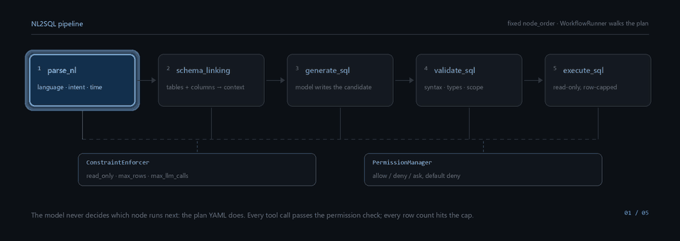
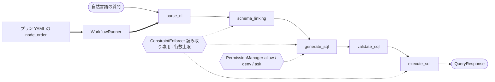

# NL2SQL データエンジニアリングエージェント

[English](README.md) | [简体中文](README.zh-CN.md) | [繁體中文](README.zh-TW.md) | **日本語**

リレーショナルデータベースに対する自然言語の質問を、検証済みの読み取り専用 SQL 文に変換する
エージェントハーネス。変換できないときは、ごまかさずにそう言う。

どのリクエストも同じ 5 つのノードを同じ順序でたどる。SQL を書くのはモデルで、次に何を実行するか、
何に触れてよいか、何行返すかはハーネスが決める。このリポジトリには「LLM が良さそうだと思った」を
制御フローのプリミティブとして扱っている箇所は一つもない。



<br>

[](https://github.com/Qorq-byte/Data_engineer/actions/workflows/checks.yml)
[](https://github.com/Qorq-byte/Data_engineer/actions/workflows/real-databases.yml)
[](LICENSE)
[](pyproject.toml)
[](pyproject.toml)
[](pyproject.toml)
[](pyproject.toml)
[](SECURITY.md)

---

## なぜこのプロジェクトか

- **ワークフローはデータであって、プロンプトではない。** 各ステップは `node_order` を明示した YAML
  プランにあり、`WorkflowRunner` がそのリストを順にたどる。モデルはステップを差し込むことも、
  飛ばすことも、自分で再試行することもできない。
- **読み取り専用は 3 回強制される。** 単一ステートメントの AST ポリシーが書き込みを拒否し、接続
  レイヤーは読み取り専用セッションを開き、`execute_sql` には書き込み経路がそもそも存在しない。
  「確認したから書いてよい」という抜け道はない。
- **失敗は一級市民である。** 途中で切れた生成、回答を装ったツール呼び出し、劣化したサブシステムは、
  それぞれ別のステータスを返す。もっともらしい成功にはまとめない。
- **ローカルファーストで、オフラインでも動く。** 埋め込みはローカルの Ollama で動き、インデックスは
  ディスク上のファイルで、`LLM_MOCK_MODE=1` ならプロバイダキーもネットワークもなしにパイプライン
  全体を走らせられる。
- **証明していないことは、証明していないと書く。** 精度のベースラインも、再現率のベンチマークも、
  容量の SLO もない。[ロードマップ](#ロードマップ)では、それを主張としてではなく未完了の作業として
  並べてある。

## 主な機能

ステータスは設計書ではなく、実行されているコードに基づく。`実装済み` は経路が接続されテストで
覆われていることを指し、`一部実装` はコードはあるものの、ドキュメントに書かれた機能の一部が動かない、
またはリクエスト経路から到達できないことを指す。

| 機能 | ステータス | 場所 |
|---|---|---|
| 固定 5 ノードの NL→SQL パイプライン | 実装済み | `app/workflow/plans/request_query.yml`、`app/harness/runner.py` |
| 制約の強制（読み取り専用、行数上限、LLM 呼び出し上限） | 実装済み | `app/harness/constraint.py` |
| ツール単位のパーミッションゲート、デフォルト拒否 | 実装済み | `app/harness/permission.py`、`app/config/agent.yml` |
| 単一ステートメントの AST 読み取り専用ポリシー | 実装済み | `app/security/sql_policy.py` |
| スキーマリンキング（テーブル、カラム、コメント、外部キー） | 実装済み | `app/nodes/schema_linking.py`、`app/knowledge/schema_graph.py` |
| 多段検証（構文、スキーマ参照、型、実行プラン、業務ルール） | 実装済み | `app/nodes/validate_sql.py`、`app/core/schema_validation.py` |
| ハイブリッド検索：BM25 + ベクトル + RRF 融合 | 実装済み | `app/rag/engine.py`、`app/knowledge/retrieval/rrf_fusion.py` |
| 業務用語集とドメインルール（ドメインごとに 1 つの YAML） | 実装済み | `app/config/domains/` |
| JWT 認証（MySQL ユーザーストア）+ 管理者許可リスト | 実装済み | `app/auth/`、`app/api/auth.py` |
| MCP の二役：4 つのサーバーを公開し、外部ツールも消費する | 実装済み | `app/mcp/servers/`、`app/mcp/client` |
| SQL ワークベンチ機能：explain、整形、検証、方言変換 | 実装済み | `app/api/sql_utils.py`、`app/nodes/` |
| リクエスト単位の使用量記録 + 任意の SQL 非保存監査 | 実装済み | `app/llm/usage.py`、`app/audit/store.py` |
| オフライン評価 CLI（SQL 契約、検索、NL2SQL バッチ） | 実装済み | `app/evaluation/`、`scripts/` |
| 実行時の自動プラン選択 | **一部実装** —— `PlanSelector` は起動時に構築されるが、リクエスト経路からは一度も呼ばれない | `main.py:89`、`app/api/query.py:285` |
| `request_query` 以外の 6 つのテンプレートプラン | **一部実装** —— 読み込まれ一覧にも出るが、API から実行できるのは `request_query` だけ | `app/api/workflows.py:39` |
| マルチエージェント編成 / サブエージェント | **一部実装** —— 起動時に登録されるが、リクエスト経路が通るのはワークフローランナー | `main.py:105` |
| フィードバック駆動のルール学習 | **一部実装** —— 収集・レビュー・統計はあるが、生成への自動反映は未接続 | `app/learning/` |
| 宣言された 11 方言のうち 7 方言 | **宣言のみ** —— [対応データベース](#対応データベース)を参照 | `app/db/connections.py:15` |
| マルチテナント分離 | **未実装** —— 単一の管理者グループが 1 つのデータセットを共有する | `app/auth/access.py` |
| 実データでの精度 / 再現率ベースライン | **未確立** | [ロードマップ](#ロードマップ)を参照 |

## アーキテクチャ

### ハーネスの不変条件

> **モデルは次のステップを選ばない。** ノードの順序はプランファイルが固定し、`WorkflowRunner` が
> 実行する。ノード同士は互いを呼ばない。各ノードは `setup_input()` → `execute()` →
> `update_context()` を実行するだけで、次に何が起きるかはランナーが決める。



ヒーローアニメーションの静止版：[`assets/pipeline.svg`](assets/pipeline.svg)。

リクエストは `POST /api/v1/query` から入る。Pydantic がボディを検証し、`model` を指定する場合は
有効化済みのプロバイダモデルでなければならない。`PlanLoader` が `request_query.yml` を返し、
ランナーが `node_order` をたどり、各ステップで制約とパーミッションが参照される。JSON、SSE、MCP は
同一の `QueryResponse` 契約を共有し、最後にトレースが永続化される。

### レイヤー

| レイヤー | ディレクトリ | 責務 |
|---|---|---|
| **API** | `app/api/` | FastAPI アプリファクトリ、13 ルーター、93 ルート。`/api/v1/*` はすべて管理者トークンを要求する |
| **Node** | `app/nodes/` | 計算単位。`BaseNode` → `AgenticNode`。起動時に 12 個の組み込みノードを登録 |
| **Harness** | `app/harness/` | 設定とプランの読み込み（mtime によるホットリロード）、ランナー、セッション、パーミッション、制約、操作履歴 |
| **DB** | `app/db/` | `ConnectionFactory`、方言ごとのスキーマイントロスペクション、sqlglot による変換、クエリ対象の凍結 |
| **Model** | `app/models/` | 素の dataclass（Pydantic は API 境界と設定にのみ登場する） |
| **Workflow** | `app/workflow/` | YAML プラン、プランセレクタ、クエリサービス、レスポンス契約 |
| **RAG** | `app/rag/`、`app/knowledge/` | LanceDB ベクトル、BM25/FTS5、RRF 融合、スキーマグラフ、用語集、メトリクス |
| **LLM** | `app/llm/` | LiteLLM ルーター、バジェット、完了ステータス判定、使用量計上、保存キーの暗号化 |
| **MCP** | `app/mcp/` | 4 つの FastMCP サーバー（`db`、`knowledge`、`vector`、`learning`）とクライアント |
| **Evaluation** | `app/evaluation/` | 凍結した受け入れセット、契約スイート、予測エクスポート、コスト見積もり |

## ディレクトリ構成

```
app/api/            13 ルーター、93 ルート、create_app() ファクトリ
app/auth/           JWT 発行、MySQL ユーザーストア、管理者ゲート
app/agents/         マルチエージェント層 —— 起動時に登録され、リクエスト経路には載らない
app/audit/          任意で有効にするローカル使用量監査ストア
app/config/         agent.yml、ドメイン YAML、サブエージェント YAML、pydantic settings
app/core/           自然言語解析、意図分類、SQL 生成と検証
app/db/             接続ファクトリ、スキーマ抽出、方言アダプタ
app/evaluation/     凍結データセット、受け入れスイート、オフライン評価
app/harness/        ランナー、プラン、制約、パーミッション、セッション
app/knowledge/      スキーマグラフ、用語集、ルールエンジン、検索プリミティブ
app/learning/       フィードバック収集、パターン分析、クエリペア
app/llm/            ルーター、バジェット、完了ポリシー、使用量、キー暗号化
app/mcp/            4 つの MCP サーバーと 1 つのクライアント
app/models/         全ドメインオブジェクトの dataclass
app/nodes/          12 ノード。request_query に並ぶ 5 つがメイン経路
app/rag/            ハイブリッド検索エンジンとインデックス保守
app/security/       読み取り専用 SQL ポリシー、キー暗号化
app/storage/        MySQL への書き込み透過永続化
app/subagent/       ドメイン単位で隔離したサブエージェントのラッパー
app/workflow/plans/ 7 つの YAML プラン、実行可能なのは 1 つ（request_query）
assets/             README のアニメーションとその静的フォールバック
docs/optimization/  設計契約と段階ごとのエンジニアリング記録
docs/archive/stages/ それら段階レポートのタイムライン索引
frontend_design/    ページのソース。npm が frontend_dist/ にコンパイルする
scripts/            ビルド、評価、負荷試験、受け入れの各エントリポイント
tests/              155 テストモジュール、763 テスト関数
```

## クイックスタート

### 必要なもの

| コンポーネント | バージョン | 理由 |
|---|---|---|
| Python | 3.12+ | CI は 3.12。コードは `StrEnum`、`match`、PEP 604 の共用体を使う |
| Node.js | 22+ | フロントエンドのビルドのみ。ビルド成果物の実行に Node は要らない |
| MySQL | 8.0+ | 認証ストア。接続できないと `/api/v1/*` はすべて 401 を返す |
| Ollama（任意） | — | ローカル埋め込み。ない場合は `RAG_EMBEDDING_PROVIDER=mock` を設定する |
| LLM キー（任意） | — | ない場合ルーターはモックモードに落ち、使える SQL は生成されない |

### 1. インストール

```bash
git clone https://github.com/Qorq-byte/Data_engineer.git
cd Data_engineer

python -m venv .venv
source .venv/bin/activate          # Windows: .venv\Scripts\activate

# -c constraints.txt はこのリポジトリで検証済みのバージョンを固定する
pip install -e ".[dev]" -c constraints.txt
```

### 2. フロントエンドのビルド

```bash
npm ci --ignore-scripts
npm run build:frontend
```

ページは `frontend_design/` から `frontend_dist/` にコンパイルされ、サーバーは後者だけを配信する。
成果物がない場合、ページ系のルートは `503 FRONTEND_NOT_BUILT` を返し、API は動作し続ける。

### 3. 設定

```bash
cp .env.example .env
python -c "import secrets; print(secrets.token_urlsafe(48))"   # JWT_SECRET に使う
```

必須は 3 つ。1 つ目が満たされない場合、アプリは起動を拒否する。

```ini
# 32 文字未満、または既定値のままだと起動時に失敗する
JWT_SECRET=<32 文字以上のランダムな文字列>
# 最初のアカウント作成に必要。空のままだと登録経路は閉じたままになる
REGISTRATION_TOKEN=<一度きりの招待文字列>
ADMIN_USER_IDS=[1]
# 認証用データベースに到達できること
AUTH_MYSQL_HOST=127.0.0.1
AUTH_MYSQL_PORT=3306
AUTH_MYSQL_USER=root
AUTH_MYSQL_PASSWORD=
AUTH_MYSQL_DATABASE=nl2sql_auth
```

### 4. 起動

```bash
python main.py          # http://localhost:8001 で待ち受ける（APP_PORT で上書き可能）
uvicorn app.api:create_app --host 0.0.0.0 --port 8001 --factory --reload   # 開発用、ホットリロード
```

インタラクティブな API ドキュメントは `/docs`。MCP サーバーは既定でポート 8080 を使う。

### 5. 最初のリクエスト

```bash
# a. 管理者アカウントを作成（REGISTRATION_TOKEN が設定されている間だけ）
curl -X POST http://localhost:8001/api/v1/auth/register \
  -H "Content-Type: application/json" \
  -d '{"username":"admin","email":"admin@example.com","password":"<strong-password>",
       "registration_token":"<the value from .env>"}'
export TOKEN="<access_token>"

# b. データベースに接続 —— SQLite が最短
curl -X POST http://localhost:8001/api/v1/databases/connect \
  -H "Authorization: Bearer $TOKEN" -H "Content-Type: application/json" \
  -d '{"db_type":"sqlite","config":{"path":"data/app.db"},"alias":"demo"}'
# → {"status":"connected","db_id":"sqlite_demo_20261101143012", ...}

# c. 質問する（フィールドの全体像は「使い方」を参照）
curl -X POST http://localhost:8001/api/v1/query \
  -H "Authorization: Bearer $TOKEN" -H "Content-Type: application/json" \
  -d '{"nl_text":"how many rows are in each table","database":"sqlite_demo_20261101143012"}'
```

プロバイダキーがない場合でも、リクエストは構造の整ったレスポンスを返す。ただし「SQL」は
`[mock response …]` というプレースホルダーになり、検証がそれを指摘する。本物の SQL を得るには
いずれかのプロバイダキーを設定する。`.env`（`DEEPSEEK_API_KEY=…`）に書くか、ワークスペースの
**設定 → LLM** から入れる。後者は MySQL に書き込む前に暗号化される。

## 使い方

### `POST /api/v1/query`

| フィールド | 型 | 既定値 | 説明 |
|---|---|---|---|
| `nl_text` | string | 必須 | 1–10000 文字。中国語または英語 |
| `session_id` | string | `""` | 使い回すとマルチターンのセッションが継続する |
| `domain` | string | `default` | `app/config/domains/` 配下のディレクトリ名 |
| `database` | string | `""` | `/api/v1/databases/connect` が返す `db_id` |
| `dialect` | string | `ansi` | 生成と検証に使う SQL 方言 |
| `num_candidates` | int | `3` | 1–5 |
| `execute` | bool | `false` | 検証が通ったあとに実行するか |
| `validate` | bool | `true` | `run_validation` の別名として受け付けられる |
| `link_schema` | bool | `true` | スキーマが不要と確信できる場合に限り無効化する |
| `model` | string | `null` | 有効化済みのプロバイダモデルでなければ 422 |

> **日本語入力について。** 質問文そのものはそのまま LLM に渡るため、日本語でも SQL が生成される
> ことはある。ただし前処理（言語判定、リミット抽出、並び順抽出）のパターンは中国語と英語しか
> 持っておらず、`language` フィールドが取りうる値も `zh` / `en` / `mixed` に限られる。日本語を
> 第一級で対応したとは主張しない。

```bash
curl -X POST http://localhost:8001/api/v1/query \
  -H "Authorization: Bearer $TOKEN" \
  -H "Content-Type: application/json" \
  -d '{
    "nl_text": "top 10 products by revenue last month",
    "domain": "ecommerce",
    "dialect": "postgresql",
    "database": "postgresql_prod_20261101143012",
    "num_candidates": 1,
    "execute": true,
    "validate": true,
    "link_schema": true
  }'
```

```jsonc
// 抜粋。入れ子のペイロードは判定を持つフィールドだけに削ってある。
{
  "query_id": "q_20261101T143012Z_4f1c",
  "session_id": "",
  "status": "completed",
  "plan_id": "request_query",
  "workflow_ids": ["wf_20261101T143012Z_9a01"],
  "llm_calls": 2,
  "nl_text": "top 10 products by revenue last month",
  "language": "en",
  "intent": "aggregation",
  "confidence": 0.82,
  "primary_sql": "SELECT p.name, SUM(o.amount) AS revenue FROM orders o JOIN products p ON p.id = o.product_id WHERE o.created_at >= DATE_TRUNC('month', CURRENT_DATE - INTERVAL '1 month') GROUP BY p.name ORDER BY revenue DESC LIMIT 10",
  "linked_tables": ["orders", "products"],
  "candidates": [
    {
      "id": "cand_1",
      "sql_text": "SELECT p.name, SUM(o.amount) AS revenue FROM orders o ...",
      "confidence": 0.82,
      "generation_mode": "primary",
      "generation_source": "model_response",
      "finish_reason": "stop",
      "execution": { "status": "success", "row_count": 10, "truncated": false }
    }
  ],
  "validation": {
    "passed": true, "syntax_ok": true, "schema_valid": true,
    "type_valid": true, "business_valid": true, "score": 0.95
  },
  "errors": [],
  "warnings": []
}
```

`status` は `completed` か `failed` のどちらか。HTTP エラーには機械可読な `code`
（`INVALID_SQL`、`TIMEOUT`、`PAYLOAD_TOO_LARGE`、`INTERNAL_ERROR` など）が付き、待てば解決する
種類のものには `Retry-After` ヘッダーも付く。完全な契約は
[docs/optimization/query-contract.md](docs/optimization/query-contract.md) にある。

### そのほかの主要エンドポイント

| エンドポイント | メソッド | 用途 |
|---|---|---|
| `/api/v1/query/stream` | POST | 同じパイプラインを SSE で。イベントはノードごと |
| `/api/v1/query/generate` | POST | 生成と検証のみ。実行はしない |
| `/api/v1/execute` | POST | SQL 文字列を直接実行する。NL パイプラインを迂回する |
| `/api/v1/schema/{db_id}` | GET | スキーマスナップショット。`/refresh` で再イントロスペクション |
| `/api/v1/settings/llm` | GET/PUT | プロバイダと既定モデル。キーは決して返さない |
| `/health` `/health/ready` | GET | 死活監視 / 準備完了（初期化、認証、実モデル、登録済みデータベース） |

## Web ワークスペース

3 つのページがあり、いずれも `frontend_dist/` から配信される。

| ページ | パス | 用途 |
|---|---|---|
| ランディング | `/` | プロジェクトの概要と入口 |
| ログイン / 登録 | `/login` | MySQL 認証ストアに対するアカウント作成 |
| ワークスペース | `/workspace` | 主画面：チャット、スキーマ、接続、ドメイン、SQL ワークベンチ、MCP、ワークフロー、学習、設定 |

ワークスペースのサイドバーには 9 つのパネルがある。クエリパネルはノードごとの進捗を流し、
SQL、検証レポート、結果テーブルを横に並べて表示する。

## 対応データベース

`DatabaseType` には 11 の方言名が宣言されているが、接続実装が動くのは 4 つだけ。残り 7 つは列挙型の
名前でしかなく、接続しようとすると `501` を投げる。

| 方言 | ドライバ | ステータス |
|---|---|---|
| SQLite | `sqlite3` | **実装済み** —— authorizer、progress deadline、スキーマバージョン追跡 |
| DuckDB | `duckdb` | **実装済み** —— 外部アクセスを無効化、interrupt によるキャンセル |
| PostgreSQL | `asyncpg` / `psycopg2` | **実装済み** —— CI で PostgreSQL 16 に対して検証済み |
| MySQL | `aiomysql` / `pymysql` | **実装済み** —— サーバー側の行数上限、CI で MySQL 8.4 に対して検証済み |
| Snowflake、StarRocks、BigQuery、Redshift、ClickHouse、Databricks、Trino | — | **宣言のみ** —— 接続経路もスキーマ抽出もない |

## 対応 LLM

ルーティングは LiteLLM を通すので、OpenAI 互換のエンドポイントなら何でもつながる。

- **専用の設定項目があるもの：** OpenAI、Anthropic、Google、DeepSeek、Qwen
- **それ以外：** ワークスペースまたは `PUT /api/v1/settings/llm` で `base_url` 付きのカスタム
  プロバイダとして登録する。キーは MySQL に保存する前に AES-GCM で暗号化される
- **キーを一切置かない：** `LLM_MOCK_MODE=1` がプレースホルダーを返すので、ハーネスの動作確認ができる

API から設定したキーは即座に有効になり、再起動をまたいで残る。`.env` のキーは起動時に読まれるだけで、
書き戻されることはない。

## テストと品質ゲート

```bash
pytest -m "not real_database"     # CI スイート：155 モジュール、763 テスト
pytest tests/test_nodes/          # 単一ディレクトリ
ruff check .                      # 行長 100、ターゲット py312
mypy app/                         # リポジトリ全体の診断。既知の技術的負債は残る
npm run check:frontend            # ページ契約 + リフレッシュ/メンテナンス処理
npm run check:frontend:build      # 再現可能なビルド。失敗時は旧成果物を残す
```

`checks.yml` は順に実行する：インストール → `npm ci` → フロントエンドの 2 検査 → `ruff check .` →
**20 個の独立した `mypy` ゲート**（strict なコア集合、評価モジュール、監査ストア、ストリーミング、
使用量）→ `pytest -m 'not real_database'`。

`real-databases.yml` は PostgreSQL 16 と MySQL 8.4 のサービスコンテナを起動し、モックモデルで
`pytest tests/real_db` を走らせる。JUnit レポートが欠けていればジョブは失敗する。

テストはモックではなく、実際の SQLite、DuckDB、LanceDB、FTS5 を使う。共有フィクスチャが
`tests/fixtures/test_schema.sql` から EC サイトのスキーマ（`users`、`products`、`orders`）を組み立てる。

## ロードマップ

未完了の作業。機能としてではなく、欠けているものとして書く。

- **精度のベースラインがない。** 30 問の NL2SQL スイートは合成問題集で、点数が意味するのは問題集の
  中での契約一致率だけ。業務上の精度ではないし、この README はそれを精度とは呼ばない。
- **意味的な再現率のベースラインがない。** 検索には凍結した qrels とオフラインの実行入口があるが、
  実際のユーザーの質問に対して測ったものは何もない。
- **容量の SLO がない。** 1k / 10k テーブルのスキーマで、4 ワーカープロセスは単一プロセスの約
  3.1–3.2 倍にとどまる。プロセス内の asyncio 並行は効かない。ボトルネックは Python の CPU だからだ。
  本番のサイジングは未検証。
- **プラン選択は配線されていない。** リクエスト経路は常に `request_query` を使う。残り 6 つのプランは
  テンプレートであって、振る舞いではない。
- **7 つの方言は名前だけ**であり、**テナント分離もない**。単一の管理者グループが 1 つのデータセットを
  共有する。
- **学習はループを閉じていない。** フィードバックは集められ、レビューもされるが、それを生成へ自動で
  戻すものは何もない。

## コントリビューション

環境構築、ブランチモデル、コミット規約、そして「ノードを 1 つ追加する」「ワークフロープランを 1 つ
追加する」ためのコピー＆ペーストできる骨組みは [CONTRIBUTING.md](CONTRIBUTING.md) にある。

## セキュリティ

サポート対象のバージョン、非公開の報告チャネル、応答までの目標、そして「Issue に秘密情報を
貼らない」という規則は [SECURITY.md](SECURITY.md) にある。このリポジトリの履歴に認証情報を見つけた
場合は、すでに漏えいしたものとして扱い、まず失効・ローテーションを行ってから報告してほしい。

## ライセンス

MIT —— [LICENSE](LICENSE) を参照。Copyright (c) 2026 Majiaqi。
