# NL2SQL Data Engineering Agent

**Ask a database a question in plain language. Get SQL you can inspect, validate and defend — or an explicit reason why you cannot.**

**English** · [简体中文](README.zh-CN.md) · [繁體中文](README.zh-TW.md) · [日本語](README.ja.md)

[](https://github.com/Qorq-byte/Data_engineer/actions/workflows/checks.yml)
[](https://github.com/Qorq-byte/Data_engineer/actions/workflows/real-databases.yml)
[](LICENSE)
[](pyproject.toml)
[](app/api/)
[](package.json)
[](app/security/sql_policy.py)
[](CONTRIBUTING.md)
[](SECURITY.md)

An agent harness that turns a natural-language question over a relational database into a validated,
read-only SQL statement. The model writes SQL; a fixed YAML plan decides what runs next, what it may
touch and how many rows come back. Every request returns evidence instead of a confidence score — and
says so when a check could not be performed.

<a href="assets/runtime-flow-static.svg"></a>

*Animated illustration, not telemetry. [Static version](assets/runtime-flow-static.svg) ·
[what the diagram claims](docs/runtime-flow.md).*

## Features

- **Deterministic control flow.** Five nodes in a fixed order, driven by `request_query.yml`. Nodes
  never call one another, and a failed node aborts instead of rerouting.
- **Read-only, enforced three times.** A single-statement AST policy, read-only driver sessions, and
  an `execute_sql` node with no write path.
- **Evidence, not a confidence score.** Each candidate records its structure source, assumptions and
  a pass/fail/unverified state per check. `confidence` is always `0` by design.
- **Schema-aware generation.** Tables, columns, keys, comments, business glossary and BM25 + vector
  retrieval fused with RRF.
- **Seven read-only connectors.** SQLite, DuckDB, PostgreSQL and MySQL are verified in CI; ClickHouse,
  Trino and StarRocks have standalone acceptance.
- **One contract, three surfaces.** The web workspace, the JSON/SSE API and the MCP server all return
  the same `QueryResponse`.

## Quick start

Requires **Python 3.12+**, **Node.js 22+** (frontend build only) and a reachable **MySQL 8.0+** auth
store.

```bash
git clone https://github.com/Qorq-byte/Data_engineer.git
cd Data_engineer

python -m venv .venv && source .venv/bin/activate    # Windows: .venv\Scripts\activate
pip install -e ".[dev]" -c constraints.txt

npm ci --ignore-scripts && npm run build:frontend    # pages are served from frontend_dist/

cp .env.example .env                                 # JWT_SECRET (32+ chars), REGISTRATION_TOKEN, ADMIN_USER_IDS
python main.py                                       # http://localhost:8001 · API docs at /docs
```

Open <http://localhost:8001>, register with the invitation from `.env`, then connect a database in the
workspace. Or call the API directly:

```bash
curl -X POST http://localhost:8001/api/v1/query \
  -H "Authorization: Bearer $TOKEN" -H "Content-Type: application/json" \
  -d '{"nl_text":"revenue by month","database":"<db_id>","execute":false}'
```

Without a model key the router falls back to mock mode: the response is well formed, but the SQL is a
placeholder and validation flags it. Without a local Ollama, set `RAG_EMBEDDING_PROVIDER=mock` in
`.env`. Authentication, connection setup, request fields and response semantics are in
[docs/usage.md](docs/usage.md).

## Documentation

- [Usage](docs/usage.md) — register, connect a target, request fields, response evidence, endpoints.
- [Architecture](docs/architecture.md) — harness invariant, layers, repository layout, design notes.
- [Support matrix](docs/support-matrix.md) — feature status, databases, models.
- [Runtime flow](docs/runtime-flow.md) — what the diagram claims and how to regenerate it.
- [Query contract](docs/optimization/query-contract.md) — status codes and error semantics.
- [Deployment and recovery](docs/optimization/immutable-workers.md) — fixed-configuration workers.

## Status and limits

This is a pre-1.0 MVP for a single administrator group. The gaps, stated as gaps:

- **Only `request_query` is executable.** Six other plans are templates; runtime plan selection is
  built at boot but never consulted.
- **No tenant isolation.** One administrator group shares one data set.
- **No calibrated accuracy, recall or capacity baseline.** The synthetic suites score contract
  matching, not business correctness.
- **Cloud databases are partial.** Snowflake's connector exists but awaits real-database acceptance;
  BigQuery, Redshift and Databricks are dialect definitions only.

The full per-feature status is in the [support matrix](docs/support-matrix.md).

## Contributing

Setup, branch model, commit conventions and skeletons for adding a node or a plan are in
[CONTRIBUTING.md](CONTRIBUTING.md). Participation is covered by the
[Code of Conduct](CODE_OF_CONDUCT.md).

## Security

Report vulnerabilities privately through [SECURITY.md](SECURITY.md), never in a public issue. Secrets
must not appear in issues, pull requests, fixtures or docs.

## License

[MIT](LICENSE) © 2026 Majiaqi.
