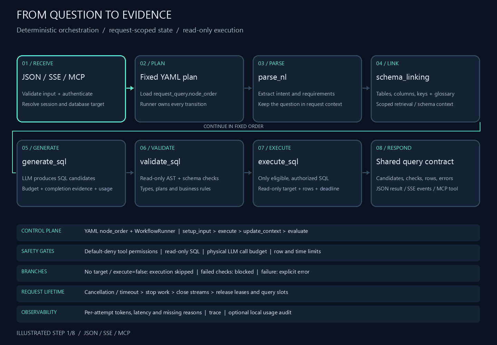
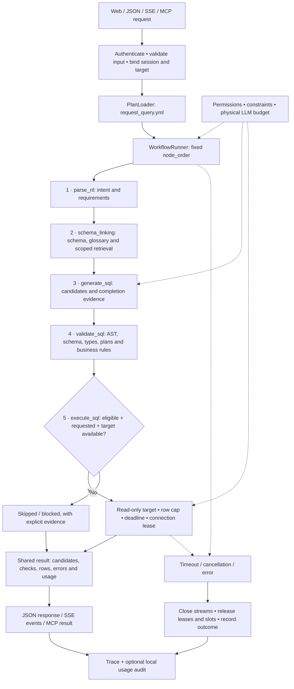

# NL2SQL Data Engineering Agent

**Natural language → SQL → validation → evidence.**

**English** · [简体中文](README.zh-CN.md) · [繁體中文](README.zh-TW.md) · [日本語](README.ja.md)

A database workbench built around a deterministic agent harness. Ask a question, inspect the
SQL and validation evidence, and optionally execute it against a read-only database target.
The model generates candidates; a fixed YAML workflow controls their execution.

[](https://github.com/Qorq-byte/Data_engineer/actions/workflows/checks.yml)
[](https://github.com/Qorq-byte/Data_engineer/actions/workflows/real-databases.yml)
[](pyproject.toml)
[](app/api/)
[](package.json)
[](LICENSE)
[](CONTRIBUTING.md)
[](SECURITY.md)

[Quick start](#quick-start) · [Runtime flow](#runtime-flow) · [Capabilities](#capabilities) · [Development](#development) · [Contributing](CONTRIBUTING.md)

## Why this project

- **Predictable control flow.** Every query follows the same five-node plan. Nodes never call one another.
- **Evidence instead of a confidence score.** Inspect schema sources, validation checks, completion status and actual execution independently. A successful query does not prove a correct business answer.
- **Bounded, read-only execution.** SQL policy, tool permissions, target permissions, row caps, deadlines and LLM budgets provide distinct safeguards.
- **One query service, multiple surfaces.** Use the web workspace, JSON API, SSE stream or MCP tools.
- **Accountable model usage.** Attempts, tokens, latency and missing telemetry belong to the request; optional local audits support traceable exports. Unknown usage or prices remain unknown.

## Runtime flow

<a href="assets/runtime-flow.png"></a>

*Architecture illustration, not live telemetry. Click for the static, motion-free version.
[Render source](scripts/render_readme_pipeline.py) · [Diagram guide](docs/runtime-flow.md).*



The runner applies `setup_input()` → `execute()` → `update_context()` and evaluation.
A skipped or blocked execution is still an explicit node outcome. The diagram does not imply
that the model can select a plan, bypass validation or reroute the workflow.

## Capabilities

- Schema-aware generation using tables, columns, foreign keys, business glossaries and retrieval.
- SQL utilities for formatting, translation, validation and query-plan inspection.
- A streaming workbench with conversation history, connection management and visible failures.
- JWT authentication, invitation-based registration and an administrator allow-list.
- BM25/vector hybrid retrieval and scoped index maintenance; actual embedding availability is explicit.
- Offline SQL-contract and retrieval evaluation, controlled model batches, prediction exports and cost estimates.

### Database support

| Database | Connector and acceptance scope |
| --- | --- |
| SQLite | `sqlite3`; read-only authorizer and execution deadlines |
| DuckDB | `duckdb`; external access disabled and cancellation support |
| PostgreSQL | `asyncpg`; PostgreSQL 16 acceptance in CI |
| MySQL | `aiomysql`; server-side result cap and MySQL 8.4 acceptance in CI |
| ClickHouse | HTTP connector; [standalone acceptance](docs/optimization/clickhouse-acceptance.md) |
| Trino | HTTP connector; [standalone acceptance](docs/optimization/trino-acceptance.md) |
| StarRocks | MySQL protocol; [standalone acceptance](docs/optimization/starrocks-acceptance.md) |
| Snowflake, BigQuery, Redshift, Databricks | Dialect definitions; do not infer a working connector |

Use native read-only target credentials. Acceptance for a fixed instance or namespace does not
establish compatibility with every server version, catalog, deployment or authentication mode.
LLM routing uses LiteLLM; configure supported providers or a compatible custom endpoint in settings.
Provider compatibility must be verified for the selected model. Mock mode exercises plumbing and
returns placeholders, not useful SQL or a model-quality result.

## Quick start

### 1. Install and build

Requirements: **Python 3.12+**, **Node.js 22+** for frontend builds, and a reachable **MySQL auth store**.
A real model endpoint is needed for useful SQL. Embeddings can use local Ollama; mock embeddings
are available for development and do not establish semantic retrieval quality.

```bash
git clone https://github.com/Qorq-byte/Data_engineer.git
cd Data_engineer
python -m venv .venv
source .venv/bin/activate  # Windows PowerShell: .venv\Scripts\Activate.ps1
pip install -e ".[dev]" -c constraints.txt
npm ci --ignore-scripts
npm run build:frontend
cp .env.example .env      # PowerShell: Copy-Item .env.example .env
python -c "import secrets; print(secrets.token_urlsafe(48))"
```

### 2. Configure `.env`

Use the generated random value for `JWT_SECRET`. Set an invitation and explicitly select the
administrator account IDs. Configure a dedicated auth-store account with the privileges required
by the application's auth schema; target database credentials are separate and should be read-only.

```dotenv
JWT_SECRET=<random secret of at least 32 characters>
REGISTRATION_TOKEN=<private invitation>
ADMIN_USER_IDS=[1]
AUTH_MYSQL_HOST=127.0.0.1
AUTH_MYSQL_PORT=3306
AUTH_MYSQL_USER=<auth-store user>
AUTH_MYSQL_PASSWORD=<auth-store password>
AUTH_MYSQL_DATABASE=nl2sql_auth
```

Choose a real provider in `.env` or **Settings → LLM**. For an explicitly synthetic development
run, set `LLM_MOCK_MODE=1` and `RAG_EMBEDDING_PROVIDER=mock`. Never commit `.env` or provider keys.
Do not assume the first newly registered user has ID 1 in an existing auth database.

### 3. Start and query

```bash
python main.py
```

Open **http://localhost:8001** (`APP_PORT` overrides the port); API documentation is at `/docs`.
Register using the invitation, sign in with an allowed administrator account, configure a model,
and connect a query target in the workspace. The frontend must be built; missing assets produce
`503 FRONTEND_NOT_BUILT` rather than silently serving a development page.

For API registration, the invitation goes in the **`X-Registration-Token` header**, not the JSON
body. Obtain an access token from `/api/v1/auth/login` (or registration), then use the `db_id`
returned by `/api/v1/databases/connect`:

```bash
curl http://localhost:8001/api/v1/query \
  -H "Authorization: Bearer $TOKEN" \
  -H "Content-Type: application/json" \
  -d '{"nl_text":"Count orders by status","database":"<db_id>","execute":true}'
```

Execution defaults to `false`. SSE uses `POST /api/v1/query/stream`; generation-only requests use
`POST /api/v1/query/generate`. Request fields and error semantics are documented in the
[query contract](docs/optimization/query-contract.md). Without a connected target, supplied
structure can support generation, but actual database execution and correctness remain unverified.

## Architecture and documentation

```text
app/api/          HTTP surfaces and app factory
app/workflow/     Query service, contracts and fixed YAML plans
app/harness/      Runner, permissions, constraints and sessions
app/nodes/        Parse → link → generate → validate → execute
app/db/           Connections, leases, introspection and dialect adapters
app/llm/          Routing, budgets, completion policy and request usage
app/rag/          Hybrid retrieval and index lifecycle
app/knowledge/    Schema graph, glossary and retrieval primitives
app/audit/        Optional local usage audit
app/mcp/          MCP servers and external-tool client
app/evaluation/   Frozen datasets and acceptance/reporting tools
frontend_design/  Frontend sources, built into frontend_dist/
```

- [Runtime diagram and lifecycle](docs/runtime-flow.md)
- [Query contract](docs/optimization/query-contract.md)
- [Deployment and recovery](docs/optimization/immutable-workers.md)
- [Release gates and acceptance evidence](docs/optimization/stage-68-release-gates.md)
- [Remaining execution plan](docs/optimization/remaining-execution-plan.md)

## Development

```bash
pytest -m "not real_database"
ruff check .
mypy app/
npm run check:frontend
npm run check:frontend:build
```

CI checks dependency snapshots, frontend contracts/build reproducibility, lint, types and tests.
Real PostgreSQL/MySQL services run in a separate workflow; other connector suites are opt-in.
Tests mix real local databases with explicit model/transport substitutes: an offline test pass
is not a live model benchmark. See [CONTRIBUTING.md](CONTRIBUTING.md) for setup and PR requirements.

## Current boundaries

This is a pre-1.0 administrator workbench. Synthetic SQL contracts do not establish business-answer
accuracy; frozen retrieval labels do not establish real-user semantic recall. Capacity measurements
have a bounded environment and workload, rather than a production SLO. Shared-worker operation is
opt-in and constrained by the [deployment contract](docs/optimization/immutable-workers.md).
There is no general multi-tenant isolation or automatic feedback-to-generation repair loop.

## Community and security

Contributions are welcome: read the [contribution guide](CONTRIBUTING.md) and follow the
[Code of Conduct](CODE_OF_CONDUCT.md). Report vulnerabilities privately through the channels in
[SECURITY.md](SECURITY.md), never in a public issue. Include a minimal, redacted reproduction.

## License

[MIT](LICENSE) · Copyright (c) 2026 Majiaqi. Third-party fonts, icons and other assets retain
their own notices; see the frontend asset licenses in the repository.
