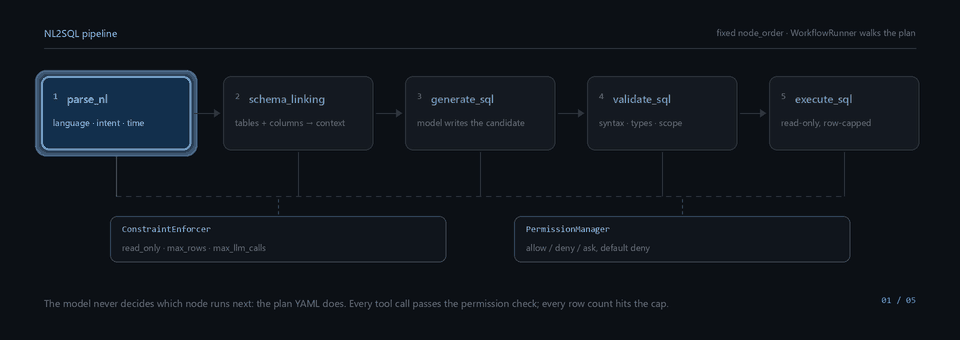
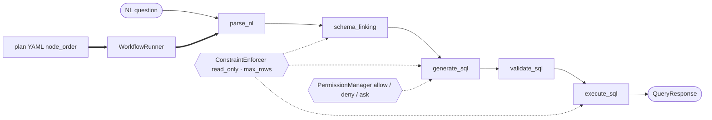

# NL2SQL Data Engineering Agent

**English** | [简体中文](README.zh-CN.md) | [繁體中文](README.zh-TW.md) | [日本語](README.ja.md)

An agent harness that turns a natural-language question over a relational database into a
validated, read-only SQL statement — and tells you honestly when it cannot.

Every request walks the same five nodes in the same order. The model writes SQL; the harness
decides what runs next, what it is allowed to touch, and how many rows come back. Nothing in
this repository treats "the LLM thought it was a good idea" as a control-flow primitive.



<br>

[](https://github.com/Qorq-byte/Data_engineer/actions/workflows/checks.yml)
[](https://github.com/Qorq-byte/Data_engineer/actions/workflows/real-databases.yml)
[](LICENSE)
[](pyproject.toml)
[](pyproject.toml)
[](pyproject.toml)
[](pyproject.toml)
[](SECURITY.md)

---

## Why this project

- **The workflow is data, not a prompt.** Each step lives in a YAML plan with an explicit
  `node_order`; `WorkflowRunner` walks that list. A model cannot insert, skip or retry a step.
- **Read-only is enforced three times.** A single-statement AST policy rejects writes, the
  connection layer opens read-only sessions, and `execute_sql` has no write path at all — there is
  no "confirm and write anyway" mode.
- **Failures are first-class.** Truncated generations, tool calls disguised as answers and
  degraded subsystems each produce a distinct status instead of a plausible-looking success.
- **Local-first, offline-capable.** Embeddings run on local Ollama, indexes are files on disk, and
  `LLM_MOCK_MODE=1` exercises the whole pipeline with no provider key and no network.
- **It says what it has not proven.** No accuracy baseline, no recall benchmark, no capacity SLO —
  the [Roadmap](#roadmap) lists them as open work rather than shipping them as claims.

## Core Features

The workbench retains the current conversation, rendered messages and running SSE
request when switching modules. “+ 新对话” opens a blank conversation. A detached
request finishes into its original history entry, including failures, without
resubmitting or placing a late response into the new conversation.

The login page links to `/register`. Registration requires the administrator's
`REGISTRATION_TOKEN` invitation and returns to login with the new email filled in.
Invalid invitations, duplicate accounts and invalid input show explicit errors.
New accounts can log in, with business access governed by the existing operator allow-list.

SQL generation works with or without a query database. In the workbench, expand
“SQL 生成选项” to choose an offline dialect and provide CREATE TABLE declarations
or field descriptions. The JSON and SSE query endpoints accept the same
`schema_ddl` and `schema_notes` fields. Connected targets use their own dialect and
introspected structure. Without a target, execution is skipped and the result is
marked as user-supplied structure or inferred, with an explicit unverified warning.

Each candidate exposes `evidence` with its structure source, capture time, dialect,
assumptions, clarification requests and individual passed/failed/unverified checks.
Cached structure is identified separately from fresh introspection. Syntax,
schema references, type heuristics, declared foreign-key relationships, configured
static business rules and actual execution have separate scopes. Undeclared or
complex joins remain unverified. Model-requested clarifications block execution.
The legacy `confidence` field is zero, indicating no calibrated probability.
The UI displays evidence instead of confidence percentages or a composite score.
Static checks and successful execution do not establish business-answer accuracy.
For compatibility, `validation.score` remains a diagnostic for performed static
checks. It is zero on a blocking failure, otherwise
`max(0.5, 1 - 0.05 * H - 0.02 * S)`, where H counts syntax/schema/type diagnostics
and S counts performance/business-rule diagnostics. Skipped checks contribute
no diagnostics. This metric does not measure coverage or SQL correctness.

Status reflects running code, not design documents. `Implemented` means the path is wired and
covered by tests; `Partial` means the code exists but a documented part of the surface does not
work or is not reachable from the request path.

| Feature | Status | Where |
|---|---|---|
| Fixed five-node NL→SQL pipeline | Implemented | `app/workflow/plans/request_query.yml`, `app/harness/runner.py` |
| Constraint enforcement (read-only, row cap, LLM call cap) | Implemented | `app/harness/constraint.py` |
| Per-tool permission gate, default deny | Implemented | `app/harness/permission.py`, `app/config/agent.yml` |
| Single-statement AST read-only policy | Implemented | `app/security/sql_policy.py` |
| Schema linking over tables, columns, comments, foreign keys | Implemented | `app/nodes/schema_linking.py`, `app/knowledge/schema_graph.py` |
| Multi-stage validation (syntax, schema refs, types, plan, business rules) | Implemented | `app/nodes/validate_sql.py`, `app/core/schema_validation.py` |
| Hybrid retrieval: BM25 + vectors + reciprocal-rank fusion | Implemented | `app/rag/engine.py`, `app/knowledge/retrieval/rrf_fusion.py` |
| Business glossary and domain rules (YAML per domain) | Implemented | `app/config/domains/` |
| JWT auth against MySQL, administrator allow-list | Implemented | `app/auth/`, `app/api/auth.py` |
| MCP in both roles: four servers exposed, external tools consumed | Implemented | `app/mcp/servers/`, `app/mcp/client` |
| SQL workbench utilities: explain, format, validate, translate | Implemented | `app/api/sql_utils.py`, `app/nodes/` |
| Request-scoped usage record plus optional SQL-free audit | Implemented | `app/llm/usage.py`, `app/audit/store.py` |
| Offline evaluation CLIs (SQL contracts, retrieval, NL2SQL batches) | Implemented | `app/evaluation/`, `scripts/` |
| Automatic plan selection at runtime | **Partial** — `PlanSelector` is built at boot and never consulted by the request path | `main.py:89`, `app/api/query.py:285` |
| Six template plans besides `request_query` | **Partial** — loaded and listed, but only `request_query` is executable through the API | `app/api/workflows.py:39` |
| Multi-agent orchestrator / sub-agents | **Partial** — registered at boot; the request path uses the workflow runner | `main.py:105` |
| Feedback-driven rule learning | **Partial** — collection, review and stats exist; no automatic repair is wired in | `app/learning/` |
| Seven read-only database connectors | Implemented and tested — see [Supported Databases](#supported-databases) | `app/db/connections.py` |
| Fixed-configuration MySQL shared workers | Opt-in, single host | [Deployment and recovery](docs/optimization/immutable-workers.md) |
| Multi-tenant isolation | **Not implemented** — one shared administrator workbench | `app/auth/access.py` |
| Answer-accuracy / recall baseline on real data | **Not established** | see [Roadmap](#roadmap) |

## Architecture

### The harness invariant

> **The model never chooses the next step.** A plan file fixes the node order; `WorkflowRunner`
> executes it. Nodes never call each other — each one runs `setup_input()` → `execute()` →
> `update_context()`, and the runner decides what happens next.



Static version of the hero animation: [`assets/pipeline.svg`](assets/pipeline.svg).

A request enters at `POST /api/v1/query`, where Pydantic validates the body and any `model`
override must match an enabled provider. `PlanLoader` returns `request_query.yml`, the runner walks
its `node_order`, constraints and permissions are consulted per step, and one `QueryResponse`
contract is shared by the JSON, SSE and MCP surfaces before the trace is persisted.

### Layers

| Layer | Directory | Responsibility |
|---|---|---|
| **API** | `app/api/` | FastAPI app factory, 13 routers, 93 routes; `/api/v1/*` all require an administrator token |
| **Node** | `app/nodes/` | Calculation units, `BaseNode` → `AgenticNode`; 12 built-in nodes registered at boot |
| **Harness** | `app/harness/` | Config and plan loading (hot-reload on mtime), runner, sessions, permissions, constraints, action history |
| **DB** | `app/db/` | `ConnectionFactory`, schema introspection per dialect, sqlglot-based translation, query targets |
| **Model** | `app/models/` | Plain dataclasses (Pydantic only at the API boundary and for settings) |
| **Workflow** | `app/workflow/` | YAML plans, plan selector, query service, response contracts |
| **RAG** | `app/rag/`, `app/knowledge/` | LanceDB vectors, BM25/FTS5, RRF fusion, schema graph, glossary, metrics |
| **LLM** | `app/llm/` | LiteLLM router, budgets, completion-status checks, usage accounting, encryption of stored keys |
| **MCP** | `app/mcp/` | Four FastMCP servers (`db`, `knowledge`, `vector`, `learning`) plus a client |
| **Evaluation** | `app/evaluation/` | Frozen acceptance sets, contract suites, prediction export, cost estimation |

## Repository Layout

```
app/api/            13 routers, 93 routes, create_app() factory
app/auth/           JWT issuing, MySQL user store, administrator gate
app/agents/         Multi-agent layer — registered at boot, not on the request path
app/audit/          Optional local usage audit store
app/config/         agent.yml, domain YAML, sub-agent YAML, pydantic settings
app/core/           NL parsing, intent classification, SQL generation and validation
app/db/             Connection factory, schema extraction, dialect adapter
app/evaluation/     Frozen datasets, acceptance suites, offline evaluation
app/harness/        Runner, plans, constraints, permissions, sessions
app/knowledge/      Schema graph, glossary, rule engine, retrieval primitives
app/learning/       Feedback collection, pattern analysis, query pairs
app/llm/            Router, budget, completion policy, usage, key crypto
app/mcp/            Four MCP servers plus a client
app/models/         Dataclasses for every domain object
app/nodes/          12 nodes; the five named in request_query are the main path
app/rag/            Hybrid retrieval engine and index maintenance
app/security/       Read-only SQL policy, key encryption
app/storage/        MySQL write-through persistence
app/subagent/       Domain-scoped sub-agent wrapper
app/workflow/plans/ 7 YAML plans, 1 executable (request_query)
assets/             README animation and its static fallback
docs/optimization/  Design contracts and the per-stage engineering record
docs/archive/stages/ Timeline index over those stage reports
frontend_design/    Source pages; compiled into frontend_dist/ by npm
scripts/            Build, evaluation, load and acceptance entry points
tests/              155 test modules, 763 test functions
```

## Quick Start

### Requirements

| Component | Version | Why |
|---|---|---|
| Python | 3.12+ | CI runs 3.12; the code uses `StrEnum`, `match`, PEP 604 unions |
| Node.js | 22+ | Only to build the frontend; the built output needs no Node at runtime |
| MySQL | 8.0+ | The auth store. Without it every `/api/v1/*` route returns 401 |
| Ollama *(optional)* | — | Local embeddings; without it set `RAG_EMBEDDING_PROVIDER=mock` |
| An LLM key *(optional)* | — | Without one the router falls back to mock mode, which yields no usable SQL |

### 1. Install

```bash
git clone https://github.com/Qorq-byte/Data_engineer.git
cd Data_engineer

python -m venv .venv
source .venv/bin/activate          # Windows: .venv\Scripts\activate

# -c constraints.txt pins the versions this repository was verified against
pip install -e ".[dev]" -c constraints.txt
```

### 2. Build the frontend

```bash
npm ci --ignore-scripts
npm run build:frontend
```

The pages are compiled from `frontend_design/` into `frontend_dist/`, and the server only ever
serves that directory. If it is missing, page routes return `503 FRONTEND_NOT_BUILT` while the
API keeps working.

### 3. Configure

```bash
cp .env.example .env
python -c "import secrets; print(secrets.token_urlsafe(48))"   # use as JWT_SECRET
```

Three values are mandatory; the app refuses to start without the first.

```ini
# Startup fails fast if this is shorter than 32 characters or left at the default.
JWT_SECRET=<at least 32 random characters>
# Required to create the first account; registration stays closed when empty.
REGISTRATION_TOKEN=<a one-time invite string>
ADMIN_USER_IDS=[1]
# The auth store must be reachable.
AUTH_MYSQL_HOST=127.0.0.1
AUTH_MYSQL_PORT=3306
AUTH_MYSQL_USER=root
AUTH_MYSQL_PASSWORD=
AUTH_MYSQL_DATABASE=nl2sql_auth
```

### 4. Run

```bash
python main.py          # listens on http://localhost:8001 (APP_PORT overrides it)
uvicorn app.api:create_app --host 0.0.0.0 --port 8001 --factory --reload   # dev, hot reload
```

Interactive API docs are at `/docs`; the MCP server binds port 8080 by default.

### 5. First request

```bash
# a. create the administrator account (only while REGISTRATION_TOKEN is set)
curl -X POST http://localhost:8001/api/v1/auth/register \
  -H "Content-Type: application/json" \
  -d '{"username":"admin","email":"admin@example.com","password":"<strong-password>",
       "registration_token":"<the value from .env>"}'
export TOKEN="<access_token>"

# b. connect a database — SQLite is the shortest path
curl -X POST http://localhost:8001/api/v1/databases/connect \
  -H "Authorization: Bearer $TOKEN" -H "Content-Type: application/json" \
  -d '{"db_type":"sqlite","config":{"path":"data/app.db"},"alias":"demo"}'
# → {"status":"connected","db_id":"sqlite_demo_20261101143012", ...}

# c. ask a question (see Usage for the full shape)
curl -X POST http://localhost:8001/api/v1/query \
  -H "Authorization: Bearer $TOKEN" -H "Content-Type: application/json" \
  -d '{"nl_text":"how many rows are in each table","database":"sqlite_demo_20261101143012"}'
```

Without an LLM provider key the request still returns a well-formed response, but the "SQL" is a
`[mock response …]` placeholder and validation flags it. To get real SQL, set one provider key —
either in `.env` (`DEEPSEEK_API_KEY=…`) or in the workspace under **Settings → LLM**, where keys
are encrypted before they reach MySQL.

## Usage

### `POST /api/v1/query`

| Field | Type | Default | Notes |
|---|---|---|---|
| `nl_text` | string | required | 1–10000 characters, Chinese or English |
| `session_id` | string | `""` | Reuse to continue a multi-turn session |
| `domain` | string | `default` | Directory name under `app/config/domains/` |
| `database` | string | `""` | `db_id` returned by `/api/v1/databases/connect` |
| `dialect` | string | `ansi` | SQL dialect used for generation and validation |
| `num_candidates` | int | `3` | 1–5 |
| `execute` | bool | `false` | Run the statement after validation |
| `validate` | bool | `true` | Accepted as an alias of `run_validation` |
| `link_schema` | bool | `true` | Skip only if you know the statement needs no schema |
| `model` | string | `null` | Must be an enabled provider model, otherwise 422 |

```bash
curl -X POST http://localhost:8001/api/v1/query \
  -H "Authorization: Bearer $TOKEN" \
  -H "Content-Type: application/json" \
  -d '{
    "nl_text": "top 10 products by revenue last month",
    "domain": "ecommerce",
    "dialect": "postgresql",
    "database": "postgresql_prod_20261101143012",
    "num_candidates": 1,
    "execute": true,
    "validate": true,
    "link_schema": true
  }'
```

```jsonc
// Abridged: nested payloads are trimmed to the fields that carry decisions.
{
  "query_id": "q_20261101T143012Z_4f1c",
  "session_id": "",
  "status": "completed",
  "plan_id": "request_query",
  "workflow_ids": ["wf_20261101T143012Z_9a01"],
  "llm_calls": 2,
  "nl_text": "top 10 products by revenue last month",
  "language": "en",
  "intent": "aggregation",
  "confidence": 0.82,
  "primary_sql": "SELECT p.name, SUM(o.amount) AS revenue FROM orders o JOIN products p ON p.id = o.product_id WHERE o.created_at >= DATE_TRUNC('month', CURRENT_DATE - INTERVAL '1 month') GROUP BY p.name ORDER BY revenue DESC LIMIT 10",
  "linked_tables": ["orders", "products"],
  "candidates": [
    {
      "id": "cand_1",
      "sql_text": "SELECT p.name, SUM(o.amount) AS revenue FROM orders o ...",
      "confidence": 0.82,
      "generation_mode": "primary",
      "generation_source": "model_response",
      "finish_reason": "stop",
      "execution": { "status": "success", "row_count": 10, "truncated": false }
    }
  ],
  "validation": {
    "passed": true, "syntax_ok": true, "schema_valid": true,
    "type_valid": true, "business_valid": true, "score": 0.95
  },
  "errors": [],
  "warnings": []
}
```

`status` is `completed` or `failed`; HTTP errors carry a machine-readable `code`
(`INVALID_SQL`, `TIMEOUT`, `PAYLOAD_TOO_LARGE`, `INTERNAL_ERROR`, …) plus a `Retry-After` header
when waiting could help. The full contract is in
[docs/optimization/query-contract.md](docs/optimization/query-contract.md).

### Other endpoints worth knowing

| Endpoint | Method | Purpose |
|---|---|---|
| `/api/v1/query/stream` | POST | Same pipeline over SSE, one event per node |
| `/api/v1/query/generate` | POST | Generate and validate, never execute |
| `/api/v1/execute` | POST | Run a SQL string directly, bypassing the NL pipeline |
| `/api/v1/schema/{db_id}` | GET | Schema snapshot; `/refresh` re-introspects |
| `/api/v1/settings/llm` | GET/PUT | Providers and default model; keys are never echoed |
| `/health` `/health/ready` | GET | Liveness vs. readiness (init, auth, real model, databases) |

## Web workspace

Three pages, all served from `frontend_dist/`:

| Page | Path | Purpose |
|---|---|---|
| Landing | `/` | What the project is and how to enter |
| Sign in / register | `/login` | Account creation against the MySQL auth store |
| Workspace | `/workspace` | The main surface: chat, schema, connections, domains, SQL workbench, MCP, workflows, learning, settings |

The workspace sidebar holds nine panels; the query panel streams node-by-node progress and shows
the SQL, the validation report and the result table side by side.

Browser acceptance exercised login, local Ollama generation, a read-only MySQL query, and
history on a narrow viewport. Embedding warnings are shown separately from the mock-model badge.

## Supported Databases

Seven connectors support read-only queries. The acceptance scope for each connector is listed below.

| Dialect | Driver | Status |
|---|---|---|
| SQLite | `sqlite3` | **Implemented** — authorizer, progress deadline, schema-version tracking |
| DuckDB | `duckdb` | **Implemented** — external access disabled, interrupt-based cancel |
| PostgreSQL | `asyncpg` | **Implemented** — verified against PostgreSQL 16 in CI |
| MySQL | `aiomysql` | **Implemented** — server-side row cap, verified against MySQL 8.4 in CI |
| ClickHouse | `httpx` | [Standalone acceptance](docs/optimization/clickhouse-acceptance.md) — one database |
| Trino | `httpx` | [Standalone acceptance](docs/optimization/trino-acceptance.md) — one catalog and schema |
| StarRocks | `aiomysql` | [Standalone acceptance](docs/optimization/starrocks-acceptance.md) — one database in the internal catalog |
| Snowflake, BigQuery, Redshift, Databricks | — | Dialect definitions only |

Use a native read-only account on the target database. The fixed-configuration multi-worker
deployment was rehearsed on a single host with a shared MySQL control plane and a MySQL query
target. See [deployment and recovery](docs/optimization/immutable-workers.md) for its constraints.

## Supported LLMs

Routing goes through LiteLLM, so any OpenAI-compatible endpoint works:

- **Providers with first-class settings:** OpenAI, Anthropic, Google, DeepSeek, Qwen
- **Anything else:** register it as a custom provider with a `base_url` in the workspace or via
  `PUT /api/v1/settings/llm`; keys are AES-GCM encrypted before being stored in MySQL
- **No key at all:** `LLM_MOCK_MODE=1` returns placeholders so you can exercise the harness

Keys configured through the API take effect immediately and survive restarts. Keys in `.env` are
read at startup and never written back.

## Testing & Quality Gates

```bash
pytest -m "not real_database"     # the regular CI suite
pytest tests/test_nodes/          # one directory
ruff check .                      # line length 100, target py312
mypy app/                         # strict application type checks
npm run check:frontend            # page contracts + refresh/maintenance handlers
npm run check:frontend:build      # reproducible build, keeps the old artefact on failure
```

`checks.yml` verifies the dependency snapshot, frontend contracts and reproducible build, lint,
type checks, and the regular pytest suite.

`real-databases.yml` runs against PostgreSQL 16 and two MySQL 8.4 instances with a mock model.
ClickHouse, Trino, and StarRocks have separate opt-in tests against disposable instances.

Tests use real SQLite, DuckDB, LanceDB and FTS5 rather than mocks; the shared fixture builds an
e-commerce schema (`users`, `products`, `orders`) from `tests/fixtures/test_schema.sql`.

The [release gates](docs/optimization/stage-68-release-gates.md) collect the browser, database
and cross-version rollback evidence. The [Ollama probe](docs/optimization/ollama-capacity-probe.md)
records a bounded embedding run. The DeepSeek probe supports a separately authorized live batch.

## Roadmap

Open work, stated as gaps rather than features:

- **No answer-accuracy baseline.** The 30-question NL2SQL suite is synthetic and scores contract
  matching inside the question set — not business accuracy, and this README will not call it that.
- **No semantic-recall baseline.** Retrieval has frozen qrels and an offline runner, but nothing
  measured against real user questions.
- **No capacity SLO.** Four worker processes reach roughly 3.1–3.2× the single-process throughput
  on 1k and 10k table schemas; in-process asyncio concurrency does not help, because the
  bottleneck is Python CPU. Production sizing is unproven.
- **Plan selection is not wired.** The request path always uses `request_query`; the other six
  plans are templates, not behaviours.
- **Cloud database acceptance is pending** for Snowflake, BigQuery, Redshift, and Databricks.
- **Tenancy is shared.** One administrator group shares one data set.
- **Learning does not close the loop.** Feedback is collected and reviewed; nothing feeds it back
  into generation automatically.

## Contributing

Environment setup, the branch model, commit conventions and copy-paste skeletons for adding a
node or a workflow plan are in [CONTRIBUTING.md](CONTRIBUTING.md).

## Security

Supported versions, the private disclosure channel, response targets and the rule that secrets
must never appear in an issue are in [SECURITY.md](SECURITY.md). If you find a credential in this
repository's history, treat it as already leaked, rotate it first, and then report.

## License

MIT — see [LICENSE](LICENSE). Copyright (c) 2026 Majiaqi.
