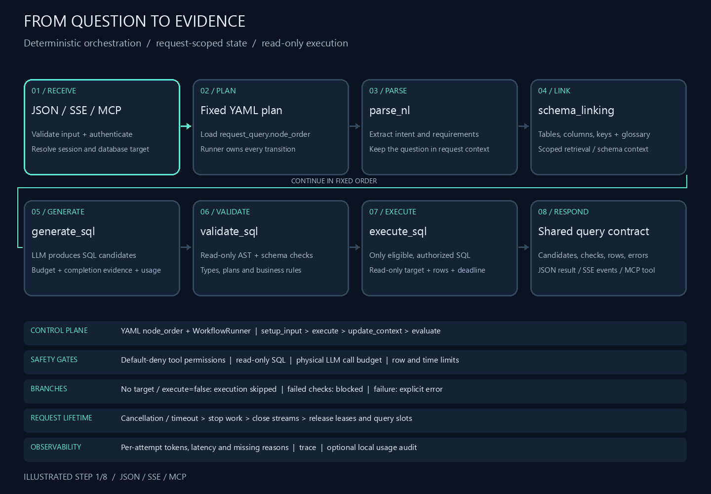

# NL2SQL 数据工程 Agent

**自然语言 → SQL → 校验 → 执行证据。**

[English](README.md) · **简体中文** · [繁體中文](README.zh-TW.md) · [日本語](README.ja.md)

基于确定性 Agent Harness 的数据库工作台：输入问题，检查 SQL 和校验证据，按需在只读目标库执行。
模型负责生成候选，固定 YAML 计划负责执行顺序。

[](https://github.com/Qorq-byte/Data_engineer/actions/workflows/checks.yml)
[](https://github.com/Qorq-byte/Data_engineer/actions/workflows/real-databases.yml)
[](pyproject.toml)
[](app/api/)
[](package.json)
[](LICENSE)
[](CONTRIBUTING.md)
[](SECURITY.md)

[快速开始](#快速开始) · [运行流程](#运行流程) · [核心能力](#核心能力) · [开发与贡献](#开发与贡献)

## 为什么使用本项目

- **固定流程**：五节点依次执行，节点之间互不调用，模型不能决定下一步。
- **可检查的证据**：分别展示结构来源、校验结果、生成完成状态和实际执行；执行成功不等于业务答案正确。
- **只读和预算约束**：SQL 策略、工具权限、数据库权限、返回行数、超时和模型调用预算各自生效。
- **统一服务**：支持网页工作台、JSON、SSE 和 MCP。
- **请求级用量**：逐次尝试记录 token、耗时和缺测原因，可选本地审计；未知用量和价格不补零。

## 运行流程

<a href="assets/runtime-flow.png"></a>

*架构示意动画，不是实时监控。点击可查看无动画静态版。*

[绘图源码](scripts/render_readme_pipeline.py) · [详细生命周期与 Mermaid 图](docs/runtime-flow.md)

1. **接入请求**：认证、参数校验，绑定会话和目标库。
2. **加载固定计划**：`request_query.yml` 的 `node_order` 交给 `WorkflowRunner`。
3. **解析问题**：`parse_nl` 提取意图和要求。
4. **关联结构**：`schema_linking` 结合表、列、外键、术语及有范围约束的检索。
5. **生成候选**：`generate_sql` 调用模型，记录完成证据和请求级用量。
6. **校验 SQL**：`validate_sql` 检查只读 AST、结构、类型、计划和业务规则。
7. **条件执行**：仅在请求执行、存在目标库且满足校验与权限条件时执行；否则明确跳过或阻断。
8. **统一响应和收尾**：输出候选、检查、结果、错误和用量；超时或取消时关闭流、释放租约与并发槽，记录结果。

节点遵循 `setup_input()` → `execute()` → `update_context()` 生命周期，由 Runner 执行评估。
流程图没有赋予模型选择计划、绕过校验或改写节点顺序的能力。

## 核心能力

- 基于表、列、外键、业务术语和检索上下文的 SQL 生成。
- SQL 格式化、翻译、校验和执行计划检查。
- 流式工作台、会话历史、连接管理和明确的失败反馈。
- JWT 认证、邀请注册和管理员白名单。
- BM25/向量混合检索与索引维护，显式显示 embedding 可用性。
- 离线 SQL 契约、检索评测、受控模型批次、预测导出与独立费用估算。

### 数据库支持范围

| 数据库 | 连接器与验收范围 |
| --- | --- |
| SQLite | `sqlite3`，只读 authorizer、执行截止 |
| DuckDB | `duckdb`，禁用外部访问、支持取消 |
| PostgreSQL | `asyncpg`，CI 验收 PostgreSQL 16 |
| MySQL | `aiomysql`，服务端结果行数限制，CI 验收 MySQL 8.4 |
| ClickHouse | HTTP，[独立验收](docs/optimization/clickhouse-acceptance.md) |
| Trino | HTTP，[独立验收](docs/optimization/trino-acceptance.md) |
| StarRocks | MySQL 协议，[独立验收](docs/optimization/starrocks-acceptance.md) |
| Snowflake、BigQuery、Redshift、Databricks | 方言定义，不能据此推断连接器可用 |

目标库应使用原生只读账号。单一实例或命名空间的验收不能外推到全部版本、目录、部署和认证方式。
模型通过 LiteLLM 路由，可在设置中配置支持的供应商或兼容端点；具体模型兼容性仍需验证。
Mock 模式返回占位内容，用于检查链路，不能产生有用 SQL 或真实模型质量结论。

## 快速开始

需要 **Python 3.12+**、构建前端所需的 **Node.js 22+**，以及可连接的 **MySQL 账号存储库**。
生成有效 SQL 需要真实模型；embedding 可用本地 Ollama，开发用 mock embedding 不代表语义质量。

```bash
git clone https://github.com/Qorq-byte/Data_engineer.git
cd Data_engineer
python -m venv .venv
source .venv/bin/activate  # Windows PowerShell: .venv\Scripts\Activate.ps1
pip install -e ".[dev]" -c constraints.txt
npm ci --ignore-scripts
npm run build:frontend
cp .env.example .env      # PowerShell: Copy-Item .env.example .env
python -c "import secrets; print(secrets.token_urlsafe(48))"
```

将随机值填入 `JWT_SECRET`，配置邀请和管理员 ID。账号存储使用独立账号，并授予应用账号表所需权限；
它与执行查询的只读目标库账号是两类凭据。

```dotenv
JWT_SECRET=<至少32字符的随机密钥>
REGISTRATION_TOKEN=<私密邀请>
ADMIN_USER_IDS=[1]
AUTH_MYSQL_HOST=127.0.0.1
AUTH_MYSQL_PORT=3306
AUTH_MYSQL_USER=<账号库用户>
AUTH_MYSQL_PASSWORD=<账号库密码>
AUTH_MYSQL_DATABASE=nl2sql_auth
```

在 `.env` 或“设置 → LLM”配置真实模型。纯开发链路可显式设置 `LLM_MOCK_MODE=1` 和
`RAG_EMBEDDING_PROVIDER=mock`。不要提交 `.env` 或密钥；已有账号库中的新用户 ID 不一定为 1。

```bash
python main.py
```

打开 **http://localhost:8001**（可通过 `APP_PORT` 修改），API 文档为 `/docs`。
通过邀请注册、使用白名单管理员登录、配置模型并连接目标库。缺少前端构建产物时返回
`503 FRONTEND_NOT_BUILT`。

API 注册邀请放在 **`X-Registration-Token` 请求头**，不是 JSON 字段。
从登录或注册接口取得 token，使用连接接口返回的 `db_id` 发起查询：

```bash
curl http://localhost:8001/api/v1/query \
  -H "Authorization: Bearer $TOKEN" \
  -H "Content-Type: application/json" \
  -d '{"nl_text":"按状态统计订单数","database":"<db_id>","execute":true}'
```

默认 `execute=false`。流式接口为 `POST /api/v1/query/stream`，仅生成接口为
`POST /api/v1/query/generate`。完整字段及错误语义见[查询契约](docs/optimization/query-contract.md)。
无连接目标时可根据提供的结构生成 SQL，但实际数据库执行与正确性仍未验证。

## 架构与文档

- `app/api/`：HTTP 接口；`app/workflow/`、`app/harness/`：查询服务、固定计划、权限和约束。
- `app/nodes/`：五节点；`app/db/`：连接、租约、结构提取和方言适配。
- `app/llm/`、`app/audit/`：路由、预算、完成状态、用量和可选审计。
- `app/rag/`、`app/knowledge/`：检索、索引、结构图和术语。
- `app/mcp/`、`app/evaluation/`：协议集成与评测工具。
- `frontend_design/`：前端源码，构建输出到 `frontend_dist/`。

[部署与恢复](docs/optimization/immutable-workers.md) ·
[发布验收证据](docs/optimization/stage-68-release-gates.md) ·
[剩余执行计划](docs/optimization/remaining-execution-plan.md)

## 开发与贡献

```bash
pytest -m "not real_database"
ruff check .
mypy app/
npm run check:frontend
npm run check:frontend:build
```

CI 检查依赖快照、前端契约与构建可重复性、Lint、类型及测试；真实 PostgreSQL/MySQL 由独立工作流运行，
其他连接器有显式启用的套件。测试既使用真实本地数据库，也使用明确的模型/传输替身；离线通过不等于真实模型基准。

贡献前请阅读 [CONTRIBUTING](CONTRIBUTING.md)，参与者遵守[行为准则](CODE_OF_CONDUCT.md)。
安全问题请按 [SECURITY](SECURITY.md) 中的私密渠道报告，提供脱敏复现，不要公开漏洞或凭据。

## 当前边界

这是 pre-1.0 管理员工作台。合成 SQL 契约不代表业务准确率，冻结检索标签不代表真实用户召回率；
容量数据仅适用于指定环境和负载，不构成生产 SLO。共享 worker 是[受约束的显式启用部署](docs/optimization/immutable-workers.md)，
没有通用多租户隔离，也没有自动将反馈注入生成的修复闭环。

## 许可证

[MIT](LICENSE) · Copyright (c) 2026 Majiaqi。第三方字体、图标及其他资源保留各自许可声明。
