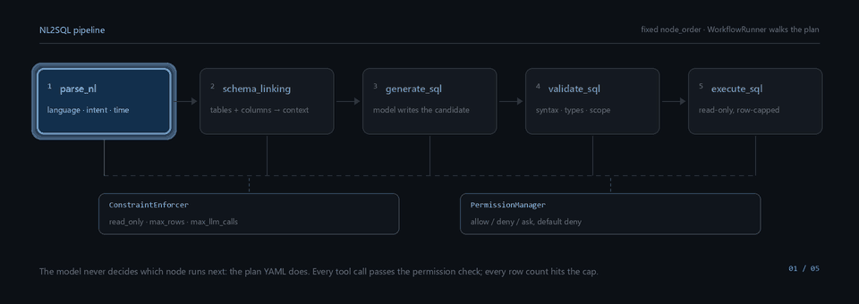
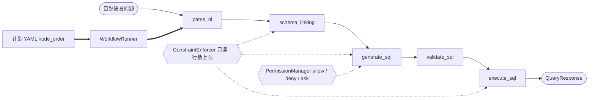

# NL2SQL 数据工程 Agent

[English](README.md) | **简体中文**

一个把自然语言问题翻译成经过校验的只读 SQL 的 Agent Harness —— 并且在该说不的时候说清楚。

每个请求都按同样的顺序走同样的五个节点。模型负责写 SQL；**跑什么节点、能碰什么、返回多少行，
由 harness 决定**。这个仓库里没有任何一处把「模型觉得这样挺好」当成控制流的依据。



<br>

[](https://github.com/Qorq-byte/Data_engineer/actions/workflows/checks.yml)
[](https://github.com/Qorq-byte/Data_engineer/actions/workflows/real-databases.yml)
[](LICENSE)
[](pyproject.toml)
[](pyproject.toml)
[](pyproject.toml)
[](pyproject.toml)
[](SECURITY.md)

---

## 为什么做这个项目

- **流程是配置，不是提示词。** 每一步都写在 YAML 计划里，`node_order` 是显式列表，
  `WorkflowRunner` 照着走。模型没法插一步、跳一步，也没法决定自己重试。
- **只读被强制三次。** 单语句 AST 策略拒绝写操作，连接层开只读会话，`execute_sql` 节点根本
  没有写入路径。不存在「确认一下就放行」的口子。
- **失败是一等公民。** 截断的生成、伪装成答案的工具调用、空结果、降级的子系统，各自给出不同
  状态，而不是一个看起来很像成功的响应。本仓库有好几个阶段就是专门用来消灭这类假成功的。
- **本地优先，可离线。** 嵌入模型跑在本机 Ollama 上，索引就是磁盘上的文件，
  `LLM_MOCK_MODE=1` 不联网、不要 Key 也能把整条流水线跑一遍。
- **没证明的事就写没证明。** 没有准确率基线、没有召回基线、没有容量 SLO，
  都放在[路线图](#路线图)里当未完成项，而不是包装成结论。

## 核心特性

下表按运行时代码标注，不按设计文档。`已实现` 指该路径已接通且有测试覆盖；`部分实现` 指代码存在，
但文档描述的能力中有一部分并未生效，或无法从请求链路触达。

| 特性 | 状态 | 位置 |
|---|---|---|
| 固定五节点 NL→SQL 流水线 | 已实现 | `app/workflow/plans/request_query.yml`、`app/harness/runner.py` |
| 约束强制（只读、行数上限、LLM 调用上限） | 已实现 | `app/harness/constraint.py` |
| 逐工具权限门，默认拒绝 | 已实现 | `app/harness/permission.py`、`app/config/agent.yml` |
| 单语句 AST 只读策略 | 已实现 | `app/security/sql_policy.py` |
| Schema Linking（表、列、注释、外键） | 已实现 | `app/nodes/schema_linking.py`、`app/knowledge/schema_graph.py` |
| 多级校验（语法、Schema 引用、类型、执行计划、业务规则） | 已实现 | `app/nodes/validate_sql.py`、`app/core/schema_validation.py` |
| 混合检索：BM25 + 向量 + RRF 融合 | 已实现 | `app/rag/engine.py`、`app/knowledge/retrieval/rrf_fusion.py` |
| 业务术语表与领域规则（每域一份 YAML） | 已实现 | `app/config/domains/` |
| JWT 认证（MySQL 用户库）+ 管理员白名单 | 已实现 | `app/auth/`、`app/api/auth.py` |
| MCP 双角色：对外 4 个 Server，对内可消费外部工具 | 已实现 | `app/mcp/servers/`、`app/mcp/client` |
| SQL 工具：Explain、格式化、校验、方言翻译 | 已实现 | `app/api/sql_utils.py`、`app/nodes/` |
| 请求级用量记录 + 可选的不存 SQL 审计 | 已实现 | `app/llm/usage.py`、`app/audit/store.py` |
| 离线评测 CLI（SQL 契约、检索、NL2SQL 批次） | 已实现 | `app/evaluation/`、`scripts/` |
| 运行时自动选计划 | **部分实现** —— `PlanSelector` 启动时构造，请求链路从不调用 | `main.py:89`、`app/api/query.py:285` |
| `request_query` 之外的 6 个计划 | **部分实现** —— 会加载、会列出，但只有 `request_query` 能通过 API 执行 | `app/api/workflows.py:39` |
| 多 Agent 编排 / 子 Agent | **部分实现** —— 启动时注册，请求链路走的是工作流执行器 | `main.py:105` |
| 反馈驱动的规则学习 | **部分实现** —— 收集、审核、统计都有，但没有自动回灌到生成 | `app/learning/` |
| 11 种声明方言中的 7 种 | **仅有声明** —— 见[支持的数据库](#支持的数据库) | `app/db/connections.py:15` |
| 多租户隔离 | **未实现** —— 单管理员组共享一份数据 | `app/auth/access.py` |
| 真实数据上的准确率 / 召回基线 | **尚未建立** | 见[路线图](#路线图) |

## 架构

### Harness 不变量

> **模型不决定下一步。** 节点顺序由计划文件固定，`WorkflowRunner` 顺序执行。节点之间互不调用，
> 每个节点只跑 `setup_input()` → `execute()` → `update_context()`，下一步做什么由执行器决定。



头图动画的静态版本：[`assets/pipeline.svg`](assets/pipeline.svg)。

请求从 `POST /api/v1/query` 进入：Pydantic 校验请求体，若指定 `model` 必须是已启用的提供商模型；
`PlanLoader` 返回 `request_query.yml`；执行器按 `node_order` 逐节点推进，约束与权限逐步生效；
JSON、SSE、MCP 共用同一份 `QueryResponse` 契约，最后持久化 trace。

### 分层

| 层 | 目录 | 职责 |
|---|---|---|
| **API** | `app/api/` | FastAPI 工厂、13 个 router、93 条路由；`/api/v1/*` 全部要求管理员令牌 |
| **Node** | `app/nodes/` | 计算单元，`BaseNode` → `AgenticNode`；启动时注册 12 个内置节点 |
| **Harness** | `app/harness/` | 配置与计划加载（按 mtime 热更新）、执行器、会话、权限、约束、操作历史 |
| **DB** | `app/db/` | `ConnectionFactory`、按方言内省、基于 sqlglot 的翻译、查询目标冻结 |
| **Model** | `app/models/` | 纯 dataclass（Pydantic 只出现在 API 边界和 settings） |
| **Workflow** | `app/workflow/` | YAML 计划、计划选择器、查询服务、响应契约 |
| **RAG** | `app/rag/`、`app/knowledge/` | LanceDB 向量、BM25/FTS5、RRF 融合、Schema 图、术语表、指标 |
| **LLM** | `app/llm/` | LiteLLM 路由、预算、完成状态判定、用量记录、密钥加密 |
| **MCP** | `app/mcp/` | 四个 FastMCP Server（`db`、`knowledge`、`vector`、`learning`）与客户端 |
| **Evaluation** | `app/evaluation/` | 冻结验收集、契约套件、预测导出、成本估算 |

## 目录结构

```
app/api/            13 个 router、93 条路由、create_app() 工厂
app/auth/           JWT 签发、MySQL 用户库、管理员门禁
app/agents/         多 Agent 层 —— 启动时注册，不在请求链路上
app/audit/          可选的本机用量审计
app/config/         agent.yml、领域 YAML、子 Agent YAML、pydantic settings
app/core/           NL 解析、意图分类、SQL 生成与校验
app/db/             连接工厂、Schema 提取、方言适配
app/evaluation/     冻结数据集、验收套件、离线评测
app/harness/        执行器、计划、约束、权限、会话
app/knowledge/      Schema 图、术语表、规则引擎、检索原语
app/learning/       反馈收集、模式分析、查询对
app/llm/            路由、预算、完成策略、用量、密钥加密
app/mcp/            四个 MCP Server 与一个客户端
app/models/         全领域 dataclass
app/nodes/          12 个节点；request_query 里的五个是主链路
app/rag/            混合检索引擎与索引维护
app/security/       只读 SQL 策略、密钥加密
app/storage/        MySQL Write-Through 持久化
app/subagent/       按领域隔离的子 Agent 封装
app/workflow/plans/ 7 个 YAML 计划，1 个可执行（request_query）
assets/             README 动画及其静态降级图
docs/optimization/  设计契约与逐阶段工程记录
docs/archive/stages/ 阶段记录的时间线索引
frontend_design/    页面源码，由 npm 编译进 frontend_dist/
scripts/            构建、评测、压测与验收入口
tests/              155 个测试模块、763 个测试函数
```

## 快速开始

### 环境要求

| 组件 | 版本 | 说明 |
|---|---|---|
| Python | 3.12+ | CI 跑 3.12；代码用到 `StrEnum`、`match`、PEP 604 联合类型 |
| Node.js | 22+ | 仅构建前端需要，构建产物运行时不依赖 Node |
| MySQL | 8.0+ | 认证存储。不通时 `/api/v1/*` 全部 401 |
| Ollama（可选） | — | 本地嵌入；没有就设 `RAG_EMBEDDING_PROVIDER=mock` |
| LLM Key（可选） | — | 没有 Key 时路由退化为 mock 模式，产不出可用 SQL |

### 1. 安装

```bash
git clone https://github.com/Qorq-byte/Data_engineer.git
cd Data_engineer

python -m venv .venv
source .venv/bin/activate          # Windows: .venv\Scripts\activate

# -c constraints.txt 锁定本仓库验收时使用的版本
pip install -e ".[dev]" -c constraints.txt
```

### 2. 构建前端

```bash
npm ci --ignore-scripts
npm run build:frontend
```

页面从 `frontend_design/` 编译到 `frontend_dist/`，服务只读后者。产物缺失时页面路由返回
`503 FRONTEND_NOT_BUILT`，API 不受影响。

### 3. 配置

```bash
cp .env.example .env
python -c "import secrets; print(secrets.token_urlsafe(48))"   # 用作 JWT_SECRET
```

三项必填，第一项不满足时服务直接拒绝启动。

```ini
# 少于 32 字符或仍是默认值时，启动即失败
JWT_SECRET=<至少 32 位随机字符>
# 为空时注册通道关闭；第一次建账号需要它
REGISTRATION_TOKEN=<一次性邀请串>
ADMIN_USER_IDS=[1]
# 认证库必须可连
AUTH_MYSQL_HOST=127.0.0.1
AUTH_MYSQL_PORT=3306
AUTH_MYSQL_USER=root
AUTH_MYSQL_PASSWORD=
AUTH_MYSQL_DATABASE=nl2sql_auth
```

### 4. 启动

```bash
python main.py          # 监听 http://localhost:8001（可用 APP_PORT 覆盖）
uvicorn app.api:create_app --host 0.0.0.0 --port 8001 --factory --reload   # 开发热重载
```

交互式文档在 `/docs`；MCP Server 默认占用 8080 端口。

### 5. 第一个请求

```bash
# a. 建管理员账号（仅在 REGISTRATION_TOKEN 非空时可用）
curl -X POST http://localhost:8001/api/v1/auth/register \
  -H "Content-Type: application/json" \
  -d '{"username":"admin","email":"admin@example.com","password":"<强密码>",
       "registration_token":"<.env 里的值>"}'
export TOKEN="<access_token>"

# b. 连一个库 —— SQLite 最省事
curl -X POST http://localhost:8001/api/v1/databases/connect \
  -H "Authorization: Bearer $TOKEN" -H "Content-Type: application/json" \
  -d '{"db_type":"sqlite","config":{"path":"data/app.db"},"alias":"demo"}'
# → {"status":"connected","db_id":"sqlite_demo_20261101143012", ...}

# c. 提一个问题（完整字段见「用法」）
curl -X POST http://localhost:8001/api/v1/query \
  -H "Authorization: Bearer $TOKEN" -H "Content-Type: application/json" \
  -d '{"nl_text":"每张表各有多少行","database":"sqlite_demo_20261101143012"}'
```

没有提供商 Key 时请求仍会返回结构完整的响应，但「SQL」是 `[mock response …]` 占位文本，校验会把它
标出来。要拿到真正的 SQL，配一个 Key：写在 `.env`（`DEEPSEEK_API_KEY=…`），或在工作台
**系统设置 → LLM** 里填，后者会先加密再落 MySQL。

## 用法

### `POST /api/v1/query`

| 字段 | 类型 | 默认 | 说明 |
|---|---|---|---|
| `nl_text` | string | 必填 | 1–10000 字符，中英文均可 |
| `session_id` | string | `""` | 复用以延续多轮会话 |
| `domain` | string | `default` | `app/config/domains/` 下的目录名 |
| `database` | string | `""` | `/api/v1/databases/connect` 返回的 `db_id` |
| `dialect` | string | `ansi` | 生成与校验使用的方言 |
| `num_candidates` | int | `3` | 1–5 |
| `execute` | bool | `false` | 校验通过后是否执行 |
| `validate` | bool | `true` | 是 `run_validation` 的别名 |
| `link_schema` | bool | `true` | 仅在确知不需要 Schema 时关闭 |
| `model` | string | `null` | 必须是已启用模型，否则 422 |

```bash
curl -X POST http://localhost:8001/api/v1/query \
  -H "Authorization: Bearer $TOKEN" \
  -H "Content-Type: application/json" \
  -d '{
    "nl_text": "上个月销售额最高的 10 个产品",
    "domain": "ecommerce",
    "dialect": "postgresql",
    "database": "postgresql_prod_20261101143012",
    "num_candidates": 1,
    "execute": true,
    "validate": true,
    "link_schema": true
  }'
```

```jsonc
// 节选：只保留携带判定结论的字段
{
  "query_id": "q_20261101T143012Z_4f1c",
  "session_id": "",
  "status": "completed",
  "plan_id": "request_query",
  "workflow_ids": ["wf_20261101T143012Z_9a01"],
  "llm_calls": 2,
  "nl_text": "上个月销售额最高的 10 个产品",
  "language": "zh",
  "intent": "aggregation",
  "confidence": 0.82,
  "primary_sql": "SELECT p.name, SUM(o.amount) AS revenue FROM orders o JOIN products p ON p.id = o.product_id WHERE o.created_at >= DATE_TRUNC('month', CURRENT_DATE - INTERVAL '1 month') GROUP BY p.name ORDER BY revenue DESC LIMIT 10",
  "linked_tables": ["orders", "products"],
  "candidates": [
    {
      "id": "cand_1",
      "sql_text": "SELECT p.name, SUM(o.amount) AS revenue FROM orders o ...",
      "confidence": 0.82,
      "generation_mode": "primary",
      "generation_source": "model_response",
      "finish_reason": "stop",
      "execution": { "status": "success", "row_count": 10, "truncated": false }
    }
  ],
  "validation": {
    "passed": true, "syntax_ok": true, "schema_valid": true,
    "type_valid": true, "business_valid": true, "score": 0.95
  },
  "errors": [],
  "warnings": []
}
```

`status` 只有 `completed` 和 `failed`；HTTP 错误带机器可读的 `code`
（`INVALID_SQL`、`TIMEOUT`、`PAYLOAD_TOO_LARGE`、`INTERNAL_ERROR` 等），值得等待时还会带
`Retry-After`。完整契约见[查询契约](docs/optimization/query-contract.md)。

### 其他常用端点

| 端点 | 方法 | 用途 |
|---|---|---|
| `/api/v1/query/stream` | POST | 同一流水线的 SSE 版本，逐节点推事件 |
| `/api/v1/query/generate` | POST | 只生成与校验，不执行 |
| `/api/v1/execute` | POST | 直接执行一段 SQL，绕过 NL 流水线 |
| `/api/v1/schema/{db_id}` | GET | Schema 快照；`/refresh` 重新内省 |
| `/api/v1/settings/llm` | GET/PUT | 提供商与默认模型；Key 永不回显 |
| `/health` `/health/ready` | GET | 存活检查 / 就绪检查（初始化、认证、真实模型、已注册库） |

## Web 工作台

三个页面，全部由 `frontend_dist/` 提供：

| 页面 | 路径 | 用途 |
|---|---|---|
| 落地页 | `/` | 项目介绍与入口 |
| 登入 / 注册 | `/login` | 基于 MySQL 认证库建号与登录 |
| 工作台 | `/workspace` | 主界面：对话、Schema、连接、领域、SQL 工作台、MCP、工作流、学习、设置 |

工作台侧边栏有九个面板；查询面板逐节点推送进度，并把 SQL、校验报告和结果表并排展示。

## 支持的数据库

`DatabaseType` 里声明了 11 种方言，其中 4 种有可用的连接实现。其余 7 种只是枚举里的名字，
连接时抛 `501`。

| 方言 | 驱动 | 状态 |
|---|---|---|
| SQLite | `sqlite3` | **已实现** —— authorizer、progress deadline、schema 版本感知 |
| DuckDB | `duckdb` | **已实现** —— 关闭外部访问，用 interrupt 取消 |
| PostgreSQL | `asyncpg` / `psycopg2` | **已实现** —— CI 对 PostgreSQL 16 实测 |
| MySQL | `aiomysql` / `pymysql` | **已实现** —— 服务端行数上限，CI 对 MySQL 8.4 实测 |
| Snowflake、StarRocks、BigQuery、Redshift、ClickHouse、Databricks、Trino | — | **仅有声明** —— 无连接路径，无 Schema 提取 |

## 支持的 LLM

统一走 LiteLLM 路由，任何 OpenAI 兼容端点都能接：

- **有专门设置项：** OpenAI、Anthropic、Google、DeepSeek、Qwen
- **其他：** 在工作台或 `PUT /api/v1/settings/llm` 里注册为自定义提供商并给 `base_url`；
  Key 以 AES-GCM 加密后写入 MySQL
- **完全不给 Key：** `LLM_MOCK_MODE=1` 返回占位内容，用来验证 harness 是否跑通

通过接口配置的 Key 立即生效并跨重启保留；`.env` 里的 Key 启动时读取，从不回写。

## 测试与质量门禁

```bash
pytest -m "not real_database"     # CI 套件：155 个模块、763 个测试
pytest tests/test_nodes/          # 单个目录
ruff check .                      # 行宽 100，target py312
mypy app/                         # 全仓诊断，仍有已知债务
npm run check:frontend            # 页面契约 + 刷新/维护处理函数
npm run check:frontend:build      # 可重复构建，失败时保留旧产物
```

`checks.yml` 依次执行：安装 → `npm ci` → 两项前端检查 → `ruff check .` → **20 条独立的
`mypy` 门禁**（strict 核心集、评测模块、审计存储、流式、用量）→ `pytest -m 'not real_database'`。

`real-databases.yml` 起 PostgreSQL 16 与 MySQL 8.4 服务容器，用 mock 模型跑
`pytest tests/real_db`；JUnit 报告缺失即判失败。

测试用真实 SQLite、DuckDB、LanceDB 与 FTS5，不做 mock；共享 fixture 由
`tests/fixtures/test_schema.sql` 构建电商 Schema（`users`、`products`、`orders`）。

## 路线图

未完成的部分，按缺口写，不按特性写：

- **没有准确率基线。** 30 题 NL2SQL 套件是合成题集，分数只表示题集内的契约匹配率，
  不是业务准确率，本文不会把它说成准确率。
- **没有语义召回基线。** 检索有冻结 qrels 和离线入口，但没在真实用户问题上测过。
- **没有容量 SLO。** 4 个独立进程在 1k / 10k 表 Schema 上约为单进程的 3.1–3.2 倍；
  进程内 asyncio 并发无效，瓶颈是 Python CPU。生产容量仍属未验证。
- **计划选择没有接线。** 请求链路固定用 `request_query`，另外 6 个计划是模板，不是行为。
- **7 种方言只有名字**，且**没有租户隔离**，单管理员组共享一份数据。
- **学习闭环没闭上。** 反馈会收集、会审核，但没有任何东西自动回灌到生成。

## 参与贡献

环境准备、分支模型、提交约定，以及「新增一个 Node / 新增一个 Workflow Plan」的可复制骨架，
见 [CONTRIBUTING.md](CONTRIBUTING.md)。

## 安全

支持版本、私密上报渠道、响应时限，以及「禁止在 Issue 里贴密钥或连接串」的规则，
见 [SECURITY.md](SECURITY.md)。若在本仓库历史中发现凭据，按已泄漏处理：先吊销轮换，再上报。

## 许可证

MIT —— 见 [LICENSE](LICENSE)。Copyright (c) 2026 Majiaqi。
