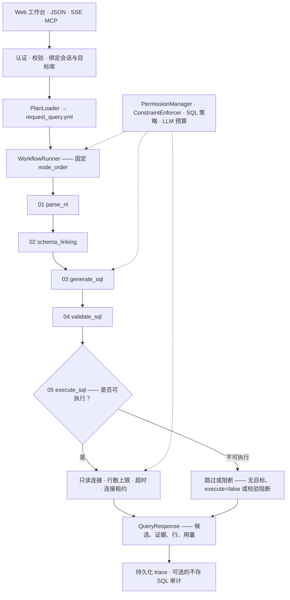

# NL2SQL 数据工程 Agent

**用自然语言向数据库提问，拿到可审查、可校验、可解释的 SQL —— 或者一句明确的「做不到」。**

[English](README.md) · **简体中文** · [繁體中文](README.zh-TW.md) · [日本語](README.ja.md)

[](https://github.com/Qorq-byte/Data_engineer/actions/workflows/checks.yml)
[](https://github.com/Qorq-byte/Data_engineer/actions/workflows/real-databases.yml)
[](LICENSE)
[](pyproject.toml)
[](app/api/)
[](package.json)
[](pyproject.toml)
[](.github/workflows/checks.yml)
[](tests/)
[](app/security/sql_policy.py)
[](CONTRIBUTING.md)
[](CODE_OF_CONDUCT.md)
[](SECURITY.md)

一个把自然语言问题翻译成**经过校验的只读 SQL** 的 Agent Harness —— 并且在该说不的时候说清楚。

每个请求都按同样的顺序走同样的五个节点。模型负责写 SQL；跑什么节点、能碰什么、返回多少行，
由 harness 决定。这个仓库里没有任何一处把「模型觉得这样挺好」当成控制流的依据。

[快速开始](#快速开始) · [运行流程](#运行流程) · [使用](#使用) · [数据库](#支持的数据库) · [架构](#架构) · [测试](#测试与质量门禁) · [路线图](#路线图)

---

## 为什么做这个项目

- **流程是配置，不是提示词。** 每一步都写在 YAML 计划里，`node_order` 是显式列表，
  `WorkflowRunner` 照着走。模型没法插一步、跳一步，也没法决定自己重试。
- **只读被强制三次。** 单语句 AST 策略拒绝写操作，连接层开只读会话，`execute_sql` 节点根本
  没有写入路径。不存在「确认一下就放行」的口子。
- **失败是一等公民。** 截断的生成、伪装成答案的工具调用、被跳过的检查、降级的子系统，各自
  给出不同状态，而不是一个看起来很像成功的响应。
- **本地优先，可离线。** 嵌入模型跑在本机 Ollama 上，索引就是磁盘上的文件，
  `LLM_MOCK_MODE=1` 不联网、不要 Key 也能把整条流水线跑一遍。
- **没证明的事就写没证明。** 没有准确率基线、没有召回基线、没有容量 SLO，都放在
  [路线图](#路线图)里当未完成项，而不是包装成结论。

## 运行流程

<a href="assets/runtime-flow-static.svg"></a>

*动态示意图，不是运行记录。点击查看[静态版](assets/runtime-flow-static.svg)；绘图源码与说明见
[`scripts/render_runtime_flow.py`](scripts/render_runtime_flow.py) 与
[`docs/runtime-flow.md`](docs/runtime-flow.md)。*

请求从 `POST /api/v1/query` 进入：Pydantic 校验请求体，若指定 `model` 必须是已启用的提供商模型；
`PlanLoader` 返回 `request_query.yml`；执行器按 `node_order` 逐节点推进，约束与权限逐步生效；
JSON、SSE、MCP 共用同一份 `QueryResponse` 契约，最后持久化 trace。

同一路径的文本版本，便于 diff：



每个节点只跑 `setup_input()` → `execute()` → `update_context()` → 评估。节点之间互不调用，
只通过 `WorkflowContext` 通信。跳过或阻断同样是一个明确的节点结果，绝不是静默的成功。

### Harness 不变量

> **模型不决定下一步。** 节点顺序由计划文件固定，`WorkflowRunner` 顺序执行。

| 保证 | 机制 | 位置 |
|---|---|---|
| 顺序 | YAML 里的 `node_order`，运行期不可插入 | `app/workflow/plans/request_query.yml` |
| 工具访问 | 逐工具 allow/deny/ask，默认拒绝 | `app/harness/permission.py`、`app/config/agent.yml` |
| 资源上限 | `read_only`、`max_rows`、`max_llm_calls` | `app/harness/constraint.py` |
| SQL 形态 | 单语句、无 DML/DDL、AST 校验 | `app/security/sql_policy.py` |
| 重试 | `max_retries: 0`，失败即中断 | 计划的 `failure_policy` |

## 特性

下表按运行时代码标注，不按设计文档。`已实现` 指该路径已接通且有测试覆盖；`部分实现` 指代码存在，
但文档描述的能力中有一部分并未生效，或无法从请求链路触达。

| 特性 | 状态 | 位置 |
|---|---|---|
| 固定五节点 NL→SQL 流水线 | 已实现 | `app/workflow/plans/request_query.yml`、`app/harness/runner.py` |
| 约束强制（只读、行数上限、LLM 调用上限） | 已实现 | `app/harness/constraint.py` |
| 逐工具权限门，默认拒绝 | 已实现 | `app/harness/permission.py`、`app/config/agent.yml` |
| 单语句 AST 只读策略 | 已实现 | `app/security/sql_policy.py` |
| Schema Linking（表、列、注释、外键） | 已实现 | `app/nodes/schema_linking.py`、`app/knowledge/schema_graph.py` |
| 多级校验（语法、Schema 引用、类型、执行计划、业务规则） | 已实现 | `app/nodes/validate_sql.py`、`app/core/schema_validation.py` |
| 混合检索：BM25 + 向量 + RRF 融合 | 已实现 | `app/rag/engine.py`、`app/knowledge/retrieval/rrf_fusion.py` |
| 业务术语表与领域规则（每域一份 YAML） | 已实现 | `app/config/domains/` |
| JWT 认证（MySQL 用户库）+ 管理员白名单 | 已实现 | `app/auth/`、`app/api/auth.py` |
| MCP 双角色：对外 4 个 Server，对内可消费外部工具 | 已实现 | `app/mcp/servers/`、`app/mcp/client` |
| SQL 工具：Explain、格式化、校验、方言翻译 | 已实现 | `app/api/sql_utils.py`、`app/nodes/` |
| 请求级用量记录 + 可选的不存 SQL 审计 | 已实现 | `app/llm/usage.py`、`app/audit/store.py` |
| 离线评测 CLI（SQL 契约、检索、NL2SQL 批次） | 已实现 | `app/evaluation/`、`scripts/` |
| 7 种只读数据库连接器 | 已实现并验收，见[支持的数据库](#支持的数据库) | `app/db/connections.py` |
| 运行时自动选计划 | **部分实现** —— `PlanSelector` 启动时构造，请求链路从不调用 | `main.py`、`app/api/query.py` |
| `request_query` 之外的 6 个计划 | **部分实现** —— 会加载、会列出，但只有 `request_query` 能通过 API 执行 | `app/api/workflows.py` |
| 多 Agent 编排 / 子 Agent | **部分实现** —— 启动时注册，请求链路走的是工作流执行器 | `main.py` |
| 反馈驱动的规则学习 | **部分实现** —— 收集、审核、统计都有，但没有自动回灌到生成 | `app/learning/` |
| 固定配置的 MySQL 多 worker | 单机按需启用 | [部署与恢复](docs/optimization/immutable-workers.md) |
| 多租户隔离 | **未实现** —— 单管理员组共享一份数据 | `app/auth/access.py` |
| 真实数据上的准确率 / 召回基线 | **尚未建立** | 见[路线图](#路线图) |

用起来是这样的：

- 切换工作台模块时，当前对话、已展示内容和运行中的 SSE 查询持续保留。点击「+ 新对话」会打开
  空白会话；上一条请求的成功结果或错误会保存到原会话历史，归属原会话，不会串到新对话里。
- 登录页可进入 `/register` 注册。注册需要管理员配置的 `REGISTRATION_TOKEN` 邀请码（放在
  `X-Registration-Token` 请求头），成功后返回登录页并预填新邮箱。邀请码错误、账号重复及输入
  不合要求均显示明确提示。新账号可正常登录，业务访问仍按现有管理员账号白名单授权。
- 智能查询支持有数据库和无数据库两种场景。展开「SQL 生成选项」可选择未连接时的方言，填写
  CREATE TABLE 建表语句及表字段说明；JSON 与 SSE 接口共用 `schema_ddl`、`schema_notes` 参数。
  连接数据库时采用目标库的真实结构和方言；未连接时只生成 SQL，醒目标识「未经真实数据库验证」，
  并列出推断的表字段和关联假设。
- 每个候选的 `evidence` 包含结构来源、采集时间、方言、假设、待澄清问题及逐项检查状态。缓存结构
  与最新内省单独标识。语法、表字段、类型启发式、外键关联、静态业务规则和实际执行各自有独立
  范围；复杂关联或未声明的关联仍需确认，模型标出的关键歧义会阻止执行。
- 兼容字段 `confidence` 恒为 `0`，表示没有经过校准的正确概率。界面逐项展示证据，不显示置信度
  百分比或综合评分。`validation.score` 只是已完成静态检查的诊断值：阻断失败时为 `0`，否则为
  `max(0.5, 1 - 0.05 × H - 0.02 × S)`，其中 H 是语法/结构/类型诊断条数，S 是性能与业务规则
  诊断条数。它既不表示验证覆盖率，也不表示 SQL 正确率。

## 架构

```text
HTTP / SSE / MCP
      │
      ├── app/api/          create_app() 工厂、13 个 router、93 条路由、认证依赖
      ├── app/workflow/     查询服务、QueryResponse 契约、7 个 YAML 计划
      ├── app/harness/      PlanLoader · WorkflowRunner · 权限 · 约束 · 会话
      ├── app/nodes/        注册 12 个节点；request_query 里的五个是主链路
      ├── app/core/         NL 解析、Prompt 构建、SQL 生成与校验
      ├── app/db/           连接工厂、Schema 内省、方言适配、连接租约
      ├── app/rag/          LanceDB 向量、BM25/FTS5、RRF 融合、索引维护
      ├── app/knowledge/    Schema 图、术语表、业务规则、检索原语
      ├── app/llm/          LiteLLM 路由、预算、完成策略、用量、密钥加密
      ├── app/auth/         JWT 签发、MySQL 用户库、管理员门禁
      ├── app/mcp/          四个 FastMCP Server 与外部工具客户端
      └── app/evaluation/   冻结验收集、契约套件、预测导出
```

| 层 | 职责 |
|---|---|
| **API** | FastAPI 工厂与路由；除认证外所有 `/api/v1/*` 都要求管理员令牌 |
| **Node** | `BaseNode` → `AgenticNode`；唯一做计算的地方 |
| **Harness** | 配置与计划加载（按 mtime 热更新）、执行、会话、权限、约束、操作历史 |
| **DB** | 11 种方言的 `ConnectionFactory`、4 种完整驱动、基于 sqlglot 的翻译、冻结查询目标 |
| **Model** | 纯 dataclass；Pydantic 只出现在 API 边界和 settings |
| **RAG** | 混合检索、Schema 图、术语表、指标 |
| **LLM** | 路由、预算、完成状态判定、用量记录、AES-GCM 密钥存储 |

读代码前值得知道的几个决定：

- **Python 3.12+** —— 用 `match`/`case`、`StrEnum`、PEP 604 联合类型。
- **领域对象用 dataclass，不用 Pydantic** —— Pydantic 只用于请求体和配置。
- **默认安全** —— 未列出的工具一律拒绝；SQL 单语句且经 AST 判定只读。
- **全局单例充当依赖注入容器**（`mcp_registry`、`settings`、`ConnectionFactory`）；每个请求
  各自构造 `NodeRegistry`。
- **测试使用真实 SQLite、DuckDB、LanceDB 和 FTS5**，不 mock。共享 fixture 从
  `tests/fixtures/test_schema.sql` 建出电商 Schema（`users`、`products`、`orders`）。
- **声明式配置** —— `agent.yml` 与工作流计划都是 YAML；`ConfigLoader` 按 mtime 热更新。

### MCP 双向

系统同时是 MCP **Server**（把 NL2SQL 作为工具与资源暴露给外部 AI 客户端，`db_server` 默认
8081 端口）和 MCP **Client**（通过 `mcp_registry` 消费外部的数据库、知识库、向量检索工具）。

## 快速开始

### 环境要求

| 组件 | 版本 | 说明 |
|---|---|---|
| Python | 3.12+ | CI 跑 3.12；代码用到 `StrEnum`、`match`、PEP 604 联合类型 |
| Node.js | 22+ | 仅构建前端需要，构建产物运行时不依赖 Node |
| MySQL | 8.0+ | 认证存储。不通时 `/api/v1/*` 全部 401 |
| Ollama（可选） | — | 本地嵌入；没有就设 `RAG_EMBEDDING_PROVIDER=mock` |
| LLM Key（可选） | — | 没有 Key 时路由退化为 mock 模式，产不出可用 SQL |

### 1. 安装

```bash
git clone https://github.com/Qorq-byte/Data_engineer.git
cd Data_engineer

python -m venv .venv
source .venv/bin/activate          # Windows: .venv\Scripts\activate

# -c constraints.txt 锁定本仓库验收时使用的版本
pip install -e ".[dev]" -c constraints.txt
```

### 2. 构建前端

```bash
npm ci --ignore-scripts
npm run build:frontend
```

页面从 `frontend_design/` 编译到 `frontend_dist/`，服务只读后者。产物缺失时页面路由返回
`503 FRONTEND_NOT_BUILT`，API 不受影响。

### 3. 配置

```bash
cp .env.example .env
python -c "import secrets; print(secrets.token_urlsafe(48))"   # 用作 JWT_SECRET
```

三项必填；第一项不满足时应用直接拒绝启动。

```ini
# 少于 32 字符或仍为默认值时启动失败
JWT_SECRET=<至少 32 位随机字符>
# 创建首个账号需要它；留空即关闭注册
REGISTRATION_TOKEN=<一次性邀请码>
ADMIN_USER_IDS=[1]
# 认证库必须可连通
AUTH_MYSQL_HOST=127.0.0.1
AUTH_MYSQL_PORT=3306
AUTH_MYSQL_USER=root
AUTH_MYSQL_PASSWORD=
AUTH_MYSQL_DATABASE=nl2sql_auth
```

认证库凭据与查询目标凭据请分开配置，查询目标使用数据库侧的原生只读账号。

### 4. 启动

```bash
python main.py          # http://localhost:8001（APP_PORT 可覆盖）
uvicorn app.api:create_app --host 0.0.0.0 --port 8001 --factory --reload   # 开发，热重载
```

交互式 API 文档在 `/docs`；MCP Server 默认绑定 8080 端口。

### 5. 第一个请求

```bash
# a. 创建管理员账号（仅当 REGISTRATION_TOKEN 已设置）
curl -X POST http://localhost:8001/api/v1/auth/register \
  -H "Content-Type: application/json" \
  -H "X-Registration-Token: <.env 里的值>" \
  -d '{"username":"admin","email":"admin@example.com","password":"<强密码>"}'
# → 201 {"access_token":"…","token_type":"bearer","user":{…}}
export TOKEN="<access_token>"

# b. 连接数据库 —— SQLite 最快
curl -X POST http://localhost:8001/api/v1/databases/connect \
  -H "Authorization: Bearer $TOKEN" -H "Content-Type: application/json" \
  -d '{"db_type":"sqlite","config":{"path":"data/app.db"},"alias":"demo"}'
# → {"status":"connected","db_id":"sqlite_demo_20261101143012", ...}

# c. 提问
curl -X POST http://localhost:8001/api/v1/query \
  -H "Authorization: Bearer $TOKEN" -H "Content-Type: application/json" \
  -d '{"nl_text":"每张表有多少行","database":"sqlite_demo_20261101143012"}'
```

没有 LLM Key 时请求仍会返回结构完整的响应，但「SQL」是 `[mock response …]` 占位符，校验会标出
问题。要拿到真实 SQL，配置一个提供商 Key —— 写在 `.env`（`DEEPSEEK_API_KEY=…`），或在工作台的
**Settings → LLM** 里填写，后者入库前会加密。

## 使用

### `POST /api/v1/query`

| 字段 | 类型 | 默认值 | 说明 |
|---|---|---|---|
| `nl_text` | string | 必填 | 1–10000 字符，中英文皆可 |
| `session_id` | string | `""` | 复用即可延续多轮会话 |
| `domain` | string | `default` | `app/config/domains/` 下的目录名 |
| `database` | string | `""` | `/api/v1/databases/connect` 返回的 `db_id` |
| `dialect` | string | `ansi` | 生成与校验使用的 SQL 方言 |
| `schema_ddl` | string | `""` | 离线场景的 CREATE TABLE 声明（≤50000 字符） |
| `schema_notes` | string | `""` | 离线场景的表字段说明 |
| `num_candidates` | int | `3` | 1–5 |
| `execute` | bool | `false` | 校验通过后是否执行 |
| `validate` | bool | `true` | 与 `run_validation` 等价 |
| `link_schema` | bool | `true` | 仅在确定语句不需要结构时关闭 |
| `model` | string | `null` | 必须是已启用的提供商模型，否则 422 |

```bash
curl -X POST http://localhost:8001/api/v1/query \
  -H "Authorization: Bearer $TOKEN" \
  -H "Content-Type: application/json" \
  -d '{
    "nl_text": "上个月收入最高的 10 个产品",
    "domain": "ecommerce",
    "dialect": "postgresql",
    "database": "postgresql_prod_20261101143012",
    "num_candidates": 1,
    "execute": true,
    "validate": true,
    "link_schema": true
  }'
```

```jsonc
// 有删节：嵌套结构只保留承载判断的字段
{
  "query_id": "q_20261101T143012Z_4f1c",
  "session_id": "",
  "status": "completed",
  "plan_id": "request_query",
  "workflow_ids": ["wf_20261101T143012Z_9a01"],
  "llm_calls": 2,
  "nl_text": "上个月收入最高的 10 个产品",
  "language": "zh",
  "intent": "aggregation",
  "confidence": 0.0,
  "primary_sql": "SELECT p.name, SUM(o.amount) AS revenue FROM orders o JOIN products p ON p.id = o.product_id WHERE o.created_at >= DATE_TRUNC('month', CURRENT_DATE - INTERVAL '1 month') GROUP BY p.name ORDER BY revenue DESC LIMIT 10",
  "linked_tables": ["orders", "products"],
  "candidates": [
    {
      "id": "cand_1",
      "sql_text": "SELECT p.name, SUM(o.amount) AS revenue FROM orders o ...",
      "confidence": 0.0,
      "generation_mode": "primary",
      "generation_source": "model_response",
      "finish_reason": "stop",
      "evidence": { "structure_source": "introspection", "dialect": "postgresql" },
      "execution": { "status": "success", "row_count": 10, "truncated": false }
    }
  ],
  "validation": {
    "passed": true, "syntax_ok": true, "schema_valid": true,
    "type_valid": true, "business_valid": true, "score": 0.95
  },
  "errors": [],
  "warnings": []
}
```

`status` 只有 `completed` 与 `failed`；HTTP 错误带机器可读的 `code`（`INVALID_SQL`、`TIMEOUT`、
`PAYLOAD_TOO_LARGE`、`INTERNAL_ERROR` 等），等待可能有效时附带 `Retry-After` 头。完整契约见
[docs/optimization/query-contract.md](docs/optimization/query-contract.md)。

### 其他常用接口

| 接口 | 方法 | 用途 |
|---|---|---|
| `/api/v1/query/stream` | POST | 同一流水线走 SSE，每个节点一个事件 |
| `/api/v1/query/generate` | POST | 只生成并校验，绝不执行 |
| `/api/v1/execute` | POST | 直接执行 SQL 字符串，绕过 NL 流水线 |
| `/api/v1/schema/{db_id}` | GET | 结构快照；`/refresh` 重新内省 |
| `/api/v1/settings/llm` | GET/PUT | 提供商与默认模型；密钥永不回显 |
| `/health` `/health/ready` | GET | 存活与就绪（初始化、认证、真实模型、数据库） |

### Python

```python
import httpx

response = httpx.post(
    "http://localhost:8001/api/v1/query",
    headers={"Authorization": f"Bearer {token}"},
    json={"nl_text": "按月统计收入", "database": db_id, "execute": False},
    timeout=120,
)
payload = response.json()
print(payload["primary_sql"], payload["validation"]["passed"])
```

## Web 工作台

三个页面，全部由 `frontend_dist/` 提供：

| 页面 | 路径 | 用途 |
|---|---|---|
| 首页 | `/` | 项目是什么、从哪进入 |
| 登录 / 注册 | `/login` | 基于 MySQL 用户库创建账号 |
| 工作台 | `/workspace` | 对话、结构、连接、领域、SQL 工具、MCP、工作流、学习、设置 |

侧边栏共九个面板；查询面板逐节点推送进度，并把 SQL、校验报告和结果表并排展示。浏览器验收覆盖
了登录、本机 Ollama 生成、只读 MySQL 查询和窄视口下的历史记录。嵌入告警与 mock 模型角标分开显示。

## 支持的数据库

7 个连接器已有只读数据库验收。Snowflake 已有连接实现，但独立真库验收尚未完成。

| 方言 | 驱动 | 状态 |
|---|---|---|
| SQLite | `sqlite3` | **已实现** —— authorizer、执行进度截止、结构版本跟踪 |
| DuckDB | `duckdb` | **已实现** —— 关闭外部访问、基于 interrupt 的取消 |
| PostgreSQL | `asyncpg` | **已实现** —— CI 中针对 PostgreSQL 16 验收 |
| MySQL | `aiomysql` | **已实现** —— 服务端行数上限，CI 中针对 MySQL 8.4 验收 |
| ClickHouse | `httpx` | [独立验收](docs/optimization/clickhouse-acceptance.md) —— 单库 |
| Trino | `httpx` | [独立验收](docs/optimization/trino-acceptance.md) —— 单 catalog 与 schema |
| StarRocks | `aiomysql` | [独立验收](docs/optimization/starrocks-acceptance.md) —— 内部 catalog 单库 |
| Snowflake | `snowflake-connector-python`（可选 extra） | 连接、只读查询、列级结构路径已实现；独立验收待完成 |
| BigQuery、Redshift、Databricks | — | 仅方言定义；连接器实现与真库验收均待完成 |

Snowflake 目前支持密码认证，以及不带引号的 database、schema、warehouse 标识符。结构提取覆盖表、
列、类型、可空性、默认值与注释；外键关系不作为已验证证据输出。安装可选驱动：
`pip install -e ".[snowflake]"`；该 extra 不在默认 `constraints.txt` 验证快照内，部署时需单独锁定。
行数上限与语句超时不会限制 Snowflake 的仓库计费。详见
[Stage 67.1 实现与验收边界](docs/optimization/stage-67-snowflake.md)。

针对单个一次性实例的验收，不代表兼容所有服务器版本、catalog、部署形态或认证方式。目标库请使用
原生只读账号。固定配置多 worker 部署只在单机、共享 MySQL 控制面和 MySQL 查询目标上演练过，
约束见[部署与恢复](docs/optimization/immutable-workers.md)。

## 支持的大模型

路由走 LiteLLM，因此任何 OpenAI 兼容端点都能接：

- **有一等配置的提供商：** OpenAI、Anthropic、Google、DeepSeek、Qwen
- **其他：** 在工作台或 `PUT /api/v1/settings/llm` 里注册为自定义提供商并给出 `base_url`；
  密钥入库前用 AES-GCM 加密
- **完全没有 Key：** `LLM_MOCK_MODE=1` 返回占位内容，用来跑通 harness

通过 API 配置的 Key 立即生效并跨重启保留；`.env` 里的 Key 只在启动时读取，永不回写。

## 目录结构

```text
app/agents/         多 Agent 层 —— 启动时注册，不在请求链路上
app/api/            13 个 router、93 条路由、create_app() 工厂
app/audit/          可选的本机用量审计
app/auth/           JWT 签发、MySQL 用户库、管理员门禁
app/config/         agent.yml、领域 YAML、子 Agent YAML、pydantic settings
app/core/           NL 解析、意图分类、SQL 生成与校验
app/db/             连接工厂、Schema 提取、方言适配
app/evaluation/     冻结数据集、验收套件、离线评测
app/harness/        执行器、计划、约束、权限、会话
app/knowledge/      Schema 图、术语表、规则引擎、检索原语
app/learning/       反馈收集、模式分析、查询对
app/llm/            路由、预算、完成策略、用量、密钥加密
app/mcp/            四个 MCP Server 与一个客户端
app/models/         全领域 dataclass
app/nodes/          12 个节点；request_query 里的五个是主链路
app/rag/            混合检索引擎与索引维护
app/security/       只读 SQL 策略、密钥加密
app/storage/        MySQL Write-Through 持久化
app/subagent/       按领域隔离的子 Agent 封装
app/workflow/plans/ 7 个 YAML 计划，1 个可执行（request_query）
assets/             运行流程示意图（动态版与静态版）
docs/optimization/  设计契约与逐阶段工程记录
docs/archive/stages/ 阶段记录的时间线索引
frontend_design/    页面源码，由 npm 编译进 frontend_dist/
scripts/            构建、评测、压测与验收入口
tests/              177 个测试模块、855 个测试函数
```

## 测试与质量门禁

```bash
pytest -m "not real_database"     # 常规 CI 套件
pytest tests/test_nodes/          # 单个目录
pytest -k "test_execute"          # 按关键字
ruff check .                      # 行宽 100，目标 py312
mypy app/                         # 应用层严格类型检查
npm run check:frontend            # 页面契约 + 刷新/维护处理器
npm run check:frontend:build      # 可重复构建，失败时保留旧产物
```

`checks.yml` 校验依赖快照、前端契约与可重复构建、lint、类型检查和常规 pytest 套件。
`real-databases.yml` 用 mock 模型跑 PostgreSQL 16 与两个 MySQL 8.4 实例。ClickHouse、Trino、
StarRocks 另有需要自备实例的 opt-in 测试。

[发布门禁](docs/optimization/stage-68-release-gates.md)汇总浏览器、数据库与跨版本回滚证据；
[Ollama 探测](docs/optimization/ollama-capacity-probe.md)记录一次有界的嵌入运行；
[Stage 64 DeepSeek 容量报告](docs/optimization/deepseek-capacity-run-2026-11-12.md)记录一批固定
合成负载，不是生产容量 SLO。

## 路线图

未完成的事，按缺口写，不按「即将上线」写：

- **没有答案准确率基线。** 30 题的 NL2SQL 套件是合成集，评的是题集内部的契约匹配，不是业务
  准确率 —— 本 README 不会把它叫作准确率。
- **没有语义召回基线。** 检索有冻结 qrels 和离线 runner，但没有针对真实用户问题的度量。
- **没有容量 SLO。** 四个 worker 进程在 1k / 10k 表结构上约为单进程吞吐的 3.1–3.2 倍；进程内
  asyncio 并发没有帮助，瓶颈在 Python CPU。生产容量仍未证明。
- **计划选择没有接线。** 请求链路固定使用 `request_query`，另外 6 个计划是模板，不是行为。
- **云数据库验收待完成。** Snowflake 连接器已实现但缺独立真库验收；BigQuery、Redshift、
  Databricks 连连接器实现都还没有。
- **租户是共享的。** 一个管理员组共用一份数据。
- **学习没有闭环。** 反馈能收集、能审核，但没有自动回灌到生成。

## 贡献

环境搭建、分支模型、提交约定，以及新增节点 / 工作流计划的骨架代码都在
[CONTRIBUTING.md](CONTRIBUTING.md)。参与即表示同意[行为准则](CODE_OF_CONDUCT.md)。文档改动可以
单独提 PR；英文 README 是首版，行为变化时请同时更新 `README.md` 与 `README.zh-CN.md`。

适合上手的改动：新增一种方言适配、为未验证路径补节点级测试，或把某个「部分实现」真正接通。

## 安全

支持的版本、私密报告渠道、响应时限，以及「任何情况下都不要在 Issue 里贴密钥」的规则见
[SECURITY.md](SECURITY.md)。如果在本仓库历史里发现凭据，请按已泄露处理：先轮换，再报告。

部署侧请做到：`.env`、模型 Key、审计文件、trace 与数据库快照不进 Git；认证库与只读查询目标使用
不同凭据；工作台只暴露给预期的管理员组。

## 许可证

[MIT](LICENSE) © 2026 Majiaqi。

第三方字体、图标等资源保留各自声明，详见仓库内的前端资源许可说明。

---

<sub>如果这个项目帮你省下了一次排查时间，点个 star 能让更多数据工程师看到它。README 里的流程图
用 `python scripts/render_runtime_flow.py` 重新生成。</sub>
