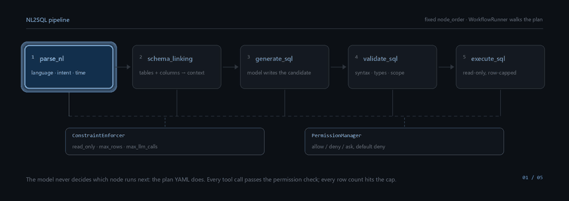
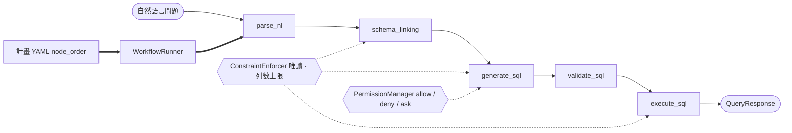

# NL2SQL 資料工程 Agent

[English](README.md) | [简体中文](README.zh-CN.md) | **繁體中文**

一套把自然語言問題翻譯成經過驗證的唯讀 SQL 的 Agent Harness —— 並且在該說不的時候說清楚。

每個請求都依照同樣的順序走同樣的五個節點。模型負責寫 SQL；**跑哪些節點、能碰什麼、回傳多少列，
由 harness 決定**。這個儲存庫裡沒有任何一處把「模型覺得這樣挺好」當成控制流程的依據。



<br>

[](https://github.com/Qorq-byte/Data_engineer/actions/workflows/checks.yml)
[](https://github.com/Qorq-byte/Data_engineer/actions/workflows/real-databases.yml)
[](LICENSE)
[](pyproject.toml)
[](pyproject.toml)
[](pyproject.toml)
[](pyproject.toml)
[](SECURITY.md)

---

## 為什麼做這個專案

- **流程是設定，不是提示詞。** 每一步都寫在 YAML 計畫裡，`node_order` 是明確的清單，
  `WorkflowRunner` 照著走。模型沒辦法插一步、跳一步，也沒辦法決定自己重試。
- **唯讀被強制三次。** 單一語句 AST 策略拒絕寫入操作，連線層開唯讀工作階段，`execute_sql` 節點
  根本沒有寫入路徑。不存在「確認一下就放行」的缺口。
- **失敗是一等公民。** 被截斷的產生結果、偽裝成答案的工具呼叫、空結果、降級的子系統，各自給出
  不同狀態，而不是一個看起來很像成功的回應。本儲存庫有好幾個階段就是專門用來消滅這類假成功。
- **本機優先，可離線。** 嵌入模型跑在本機 Ollama 上，索引就是磁碟上的檔案，
  `LLM_MOCK_MODE=1` 不連網、不要金鑰也能把整條管線跑一遍。
- **沒證明的事就寫沒證明。** 沒有準確率基準、沒有召回基準、沒有容量 SLO，
  都放在[路線圖](#路線圖)裡當未完成項，而不是包裝成結論。

## 核心特性

下表依執行時程式碼標註，不依設計文件。`已實作` 指該路徑已接通且有測試涵蓋；`部分實作` 指程式碼存在，
但文件描述的能力中有一部分並未生效，或無法從請求鏈路觸達。

| 特性 | 狀態 | 位置 |
|---|---|---|
| 固定五節點 NL→SQL 管線 | 已實作 | `app/workflow/plans/request_query.yml`、`app/harness/runner.py` |
| 約束強制（唯讀、列數上限、LLM 呼叫上限） | 已實作 | `app/harness/constraint.py` |
| 逐工具權限閘門，預設拒絕 | 已實作 | `app/harness/permission.py`、`app/config/agent.yml` |
| 單一語句 AST 唯讀策略 | 已實作 | `app/security/sql_policy.py` |
| Schema Linking（資料表、欄位、註解、外鍵） | 已實作 | `app/nodes/schema_linking.py`、`app/knowledge/schema_graph.py` |
| 多層驗證（語法、Schema 參照、型別、執行計畫、業務規則） | 已實作 | `app/nodes/validate_sql.py`、`app/core/schema_validation.py` |
| 混合檢索：BM25 + 向量 + RRF 融合 | 已實作 | `app/rag/engine.py`、`app/knowledge/retrieval/rrf_fusion.py` |
| 業務術語表與領域規則（每域一份 YAML） | 已實作 | `app/config/domains/` |
| JWT 驗證（MySQL 使用者資料庫）+ 管理員白名單 | 已實作 | `app/auth/`、`app/api/auth.py` |
| MCP 雙角色：對外 4 個 Server，對內可消費外部工具 | 已實作 | `app/mcp/servers/`、`app/mcp/client` |
| SQL 工具：Explain、格式化、驗證、方言轉譯 | 已實作 | `app/api/sql_utils.py`、`app/nodes/` |
| 請求級用量紀錄 + 可選的不存 SQL 稽核 | 已實作 | `app/llm/usage.py`、`app/audit/store.py` |
| 離線評測 CLI（SQL 契約、檢索、NL2SQL 批次） | 已實作 | `app/evaluation/`、`scripts/` |
| 執行時自動選計畫 | **部分實作** —— `PlanSelector` 啟動時建構，請求鏈路從不呼叫 | `main.py:89`、`app/api/query.py:285` |
| `request_query` 之外的 6 個計畫 | **部分實作** —— 會載入、會列出，但只有 `request_query` 能透過 API 執行 | `app/api/workflows.py:39` |
| 多 Agent 編排 / 子 Agent | **部分實作** —— 啟動時註冊，請求鏈路走的是工作流程執行器 | `main.py:105` |
| 回饋驅動的規則學習 | **部分實作** —— 收集、審核、統計都有，但沒有自動回灌到產生 | `app/learning/` |
| 11 種宣告方言中的 7 種 | **僅有宣告** —— 見[支援的資料庫](#支援的資料庫) | `app/db/connections.py:15` |
| 多租戶隔離 | **未實作** —— 單一管理員群組共用一份資料 | `app/auth/access.py` |
| 真實資料上的準確率 / 召回基準 | **尚未建立** | 見[路線圖](#路線圖) |

## 架構

### Harness 不變量

> **模型不決定下一步。** 節點順序由計畫檔案固定，`WorkflowRunner` 依序執行。節點之間互不呼叫，
> 每個節點只跑 `setup_input()` → `execute()` → `update_context()`，下一步做什麼由執行器決定。



標頭動畫的靜態版本：[`assets/pipeline.svg`](assets/pipeline.svg)。

請求從 `POST /api/v1/query` 進入：Pydantic 驗證請求內容，若指定 `model` 必須是已啟用的供應商模型；
`PlanLoader` 回傳 `request_query.yml`；執行器依 `node_order` 逐節點推進，約束與權限逐步生效；
JSON、SSE、MCP 共用同一份 `QueryResponse` 契約，最後持久化 trace。

### 分層

| 層 | 目錄 | 職責 |
|---|---|---|
| **API** | `app/api/` | FastAPI 工廠、13 個 router、93 條路由；`/api/v1/*` 全部要求管理員權杖 |
| **Node** | `app/nodes/` | 計算單元，`BaseNode` → `AgenticNode`；啟動時註冊 12 個內建節點 |
| **Harness** | `app/harness/` | 設定與計畫載入（依 mtime 熱更新）、執行器、工作階段、權限、約束、操作歷史 |
| **DB** | `app/db/` | `ConnectionFactory`、依方言內省、基於 sqlglot 的轉譯、查詢目標凍結 |
| **Model** | `app/models/` | 純 dataclass（Pydantic 只出現在 API 邊界與 settings） |
| **Workflow** | `app/workflow/` | YAML 計畫、計畫選擇器、查詢服務、回應契約 |
| **RAG** | `app/rag/`、`app/knowledge/` | LanceDB 向量、BM25/FTS5、RRF 融合、Schema 圖、術語表、指標 |
| **LLM** | `app/llm/` | LiteLLM 路由、預算、完成狀態判定、用量紀錄、金鑰加密 |
| **MCP** | `app/mcp/` | 四個 FastMCP Server（`db`、`knowledge`、`vector`、`learning`）與用戶端 |
| **Evaluation** | `app/evaluation/` | 凍結驗收集、契約套件、預測匯出、成本估算 |

## 目錄結構

```
app/api/            13 個 router、93 條路由、create_app() 工廠
app/auth/           JWT 簽發、MySQL 使用者資料庫、管理員閘門
app/agents/         多 Agent 層 —— 啟動時註冊，不在請求鏈路上
app/audit/          可選的本機用量稽核
app/config/         agent.yml、領域 YAML、子 Agent YAML、pydantic settings
app/core/           NL 解析、意圖分類、SQL 產生與驗證
app/db/             連線工廠、Schema 擷取、方言轉接
app/evaluation/     凍結資料集、驗收套件、離線評測
app/harness/        執行器、計畫、約束、權限、工作階段
app/knowledge/      Schema 圖、術語表、規則引擎、檢索原語
app/learning/       回饋收集、模式分析、查詢對
app/llm/            路由、預算、完成策略、用量、金鑰加密
app/mcp/            四個 MCP Server 與一個用戶端
app/models/         全領域 dataclass
app/nodes/          12 個節點；request_query 裡的五個是主鏈路
app/rag/            混合檢索引擎與索引維護
app/security/       唯讀 SQL 策略、金鑰加密
app/storage/        MySQL Write-Through 持久化
app/subagent/       依領域隔離的子 Agent 封裝
app/workflow/plans/ 7 個 YAML 計畫，1 個可執行（request_query）
assets/             README 動畫及其靜態降級圖
docs/optimization/  設計契約與逐階段工程紀錄
docs/archive/stages/ 階段紀錄的時間軸索引
frontend_design/    頁面原始碼，由 npm 編譯進 frontend_dist/
scripts/            建置、評測、壓測與驗收入口
tests/              155 個測試模組、763 個測試函式
```

## 快速開始

### 環境需求

| 元件 | 版本 | 說明 |
|---|---|---|
| Python | 3.12+ | CI 跑 3.12；程式碼用到 `StrEnum`、`match`、PEP 604 聯合型別 |
| Node.js | 22+ | 僅建置前端需要，建置產物執行時不依賴 Node |
| MySQL | 8.0+ | 驗證儲存。不通時 `/api/v1/*` 全部 401 |
| Ollama（選用） | — | 本機嵌入；沒有就設 `RAG_EMBEDDING_PROVIDER=mock` |
| LLM 金鑰（選用） | — | 沒有金鑰時路由退化為 mock 模式，產不出可用 SQL |

### 1. 安裝

```bash
git clone https://github.com/Qorq-byte/Data_engineer.git
cd Data_engineer

python -m venv .venv
source .venv/bin/activate          # Windows: .venv\Scripts\activate

# -c constraints.txt 鎖定本儲存庫驗收時使用的版本
pip install -e ".[dev]" -c constraints.txt
```

### 2. 建置前端

```bash
npm ci --ignore-scripts
npm run build:frontend
```

頁面從 `frontend_design/` 編譯到 `frontend_dist/`，服務只讀後者。產物缺失時頁面路由回傳
`503 FRONTEND_NOT_BUILT`，API 不受影響。

### 3. 設定

```bash
cp .env.example .env
python -c "import secrets; print(secrets.token_urlsafe(48))"   # 用作 JWT_SECRET
```

三項必填，第一項不滿足時服務直接拒絕啟動。

```ini
# 少於 32 個字元或仍是預設值時，啟動即失敗
JWT_SECRET=<至少 32 位隨機字元>
# 為空時註冊通道關閉；第一次建帳號需要它
REGISTRATION_TOKEN=<一次性邀請碼>
ADMIN_USER_IDS=[1]
# 驗證資料庫必須可連線
AUTH_MYSQL_HOST=127.0.0.1
AUTH_MYSQL_PORT=3306
AUTH_MYSQL_USER=root
AUTH_MYSQL_PASSWORD=
AUTH_MYSQL_DATABASE=nl2sql_auth
```

### 4. 啟動

```bash
python main.py          # 監聽 http://localhost:8001（可用 APP_PORT 覆蓋）
uvicorn app.api:create_app --host 0.0.0.0 --port 8001 --factory --reload   # 開發熱重載
```

互動式文件在 `/docs`；MCP Server 預設佔用 8080 埠。

### 5. 第一個請求

```bash
# a. 建管理員帳號（僅在 REGISTRATION_TOKEN 非空時可用）
curl -X POST http://localhost:8001/api/v1/auth/register \
  -H "Content-Type: application/json" \
  -d '{"username":"admin","email":"admin@example.com","password":"<高強度密碼>",
       "registration_token":"<.env 裡的值>"}'
export TOKEN="<access_token>"

# b. 連一個資料庫 —— SQLite 最省事
curl -X POST http://localhost:8001/api/v1/databases/connect \
  -H "Authorization: Bearer $TOKEN" -H "Content-Type: application/json" \
  -d '{"db_type":"sqlite","config":{"path":"data/app.db"},"alias":"demo"}'
# → {"status":"connected","db_id":"sqlite_demo_20261101143012", ...}

# c. 提一個問題（完整欄位見「用法」）
curl -X POST http://localhost:8001/api/v1/query \
  -H "Authorization: Bearer $TOKEN" -H "Content-Type: application/json" \
  -d '{"nl_text":"每張資料表各有多少列","database":"sqlite_demo_20261101143012"}'
```

沒有供應商金鑰時請求仍會回傳結構完整的回應，但「SQL」是 `[mock response …]` 佔位文字，驗證會把它
標出來。要拿到真正的 SQL，配一個金鑰：寫在 `.env`（`DEEPSEEK_API_KEY=…`），或在工作台
**系統設定 → LLM** 裡填，後者會先加密再落 MySQL。

## 用法

### `POST /api/v1/query`

| 欄位 | 型別 | 預設 | 說明 |
|---|---|---|---|
| `nl_text` | string | 必填 | 1–10000 字元，中英文均可 |
| `session_id` | string | `""` | 複用以延續多輪工作階段 |
| `domain` | string | `default` | `app/config/domains/` 下的目錄名 |
| `database` | string | `""` | `/api/v1/databases/connect` 回傳的 `db_id` |
| `dialect` | string | `ansi` | 產生與驗證使用的方言 |
| `num_candidates` | int | `3` | 1–5 |
| `execute` | bool | `false` | 驗證通過後是否執行 |
| `validate` | bool | `true` | 是 `run_validation` 的別名 |
| `link_schema` | bool | `true` | 僅在確知不需要 Schema 時關閉 |
| `model` | string | `null` | 必須是已啟用模型，否則 422 |

```bash
curl -X POST http://localhost:8001/api/v1/query \
  -H "Authorization: Bearer $TOKEN" \
  -H "Content-Type: application/json" \
  -d '{
    "nl_text": "上個月銷售額最高的 10 個產品",
    "domain": "ecommerce",
    "dialect": "postgresql",
    "database": "postgresql_prod_20261101143012",
    "num_candidates": 1,
    "execute": true,
    "validate": true,
    "link_schema": true
  }'
```

```jsonc
// 節選：只保留攜帶判定結論的欄位
{
  "query_id": "q_20261101T143012Z_4f1c",
  "session_id": "",
  "status": "completed",
  "plan_id": "request_query",
  "workflow_ids": ["wf_20261101T143012Z_9a01"],
  "llm_calls": 2,
  "nl_text": "上個月銷售額最高的 10 個產品",
  "language": "zh",
  "intent": "aggregation",
  "confidence": 0.82,
  "primary_sql": "SELECT p.name, SUM(o.amount) AS revenue FROM orders o JOIN products p ON p.id = o.product_id WHERE o.created_at >= DATE_TRUNC('month', CURRENT_DATE - INTERVAL '1 month') GROUP BY p.name ORDER BY revenue DESC LIMIT 10",
  "linked_tables": ["orders", "products"],
  "candidates": [
    {
      "id": "cand_1",
      "sql_text": "SELECT p.name, SUM(o.amount) AS revenue FROM orders o ...",
      "confidence": 0.82,
      "generation_mode": "primary",
      "generation_source": "model_response",
      "finish_reason": "stop",
      "execution": { "status": "success", "row_count": 10, "truncated": false }
    }
  ],
  "validation": {
    "passed": true, "syntax_ok": true, "schema_valid": true,
    "type_valid": true, "business_valid": true, "score": 0.95
  },
  "errors": [],
  "warnings": []
}
```

`status` 只有 `completed` 和 `failed`；HTTP 錯誤帶機器可讀的 `code`
（`INVALID_SQL`、`TIMEOUT`、`PAYLOAD_TOO_LARGE`、`INTERNAL_ERROR` 等），值得等待時還會帶
`Retry-After`。完整契約見[查詢契約](docs/optimization/query-contract.md)。

### 其他常用端點

| 端點 | 方法 | 用途 |
|---|---|---|
| `/api/v1/query/stream` | POST | 同一條管線的 SSE 版本，逐節點推送事件 |
| `/api/v1/query/generate` | POST | 只產生與驗證，不執行 |
| `/api/v1/execute` | POST | 直接執行一段 SQL，繞過 NL 管線 |
| `/api/v1/schema/{db_id}` | GET | Schema 快照；`/refresh` 重新內省 |
| `/api/v1/settings/llm` | GET/PUT | 供應商與預設模型；金鑰永不回顯 |
| `/health` `/health/ready` | GET | 存活檢查 / 就緒檢查（初始化、驗證、真實模型、已註冊資料庫） |

## Web 工作台

三個頁面，全部由 `frontend_dist/` 提供：

| 頁面 | 路徑 | 用途 |
|---|---|---|
| 首頁 | `/` | 專案介紹與入口 |
| 登入 / 註冊 | `/login` | 基於 MySQL 驗證儲存建帳號與登入 |
| 工作台 | `/workspace` | 主介面：對話、Schema、連線、領域、SQL 工作台、MCP、工作流程、學習、設定 |

工作台側邊欄有九個面板；查詢面板逐節點推送進度，並把 SQL、驗證報告和結果表並排顯示。

## 支援的資料庫

`DatabaseType` 裡宣告了 11 種方言，其中 4 種有可用的連線實作。其餘 7 種只是列舉裡的名字，
連線時拋 `501`。

| 方言 | 驅動程式 | 狀態 |
|---|---|---|
| SQLite | `sqlite3` | **已實作** —— authorizer、progress deadline、schema 版本感知 |
| DuckDB | `duckdb` | **已實作** —— 關閉外部存取，用 interrupt 取消 |
| PostgreSQL | `asyncpg` / `psycopg2` | **已實作** —— CI 對 PostgreSQL 16 實測 |
| MySQL | `aiomysql` / `pymysql` | **已實作** —— 伺服器端列數上限，CI 對 MySQL 8.4 實測 |
| Snowflake、StarRocks、BigQuery、Redshift、ClickHouse、Databricks、Trino | — | **僅有宣告** —— 無連線路徑，無 Schema 擷取 |

## 支援的 LLM

統一走 LiteLLM 路由，任何 OpenAI 相容端點都能接：

- **有專門設定項：** OpenAI、Anthropic、Google、DeepSeek、Qwen
- **其他：** 在工作台或 `PUT /api/v1/settings/llm` 裡註冊為自訂供應商並給 `base_url`；
  金鑰以 AES-GCM 加密後寫入 MySQL
- **完全不給金鑰：** `LLM_MOCK_MODE=1` 回傳佔位內容，用來驗證 harness 是否跑通

透過介面設定的金鑰立即生效並跨重啟保留；`.env` 裡的金鑰啟動時讀取，從不回寫。

## 測試與品質關卡

```bash
pytest -m "not real_database"     # CI 套件：155 個模組、763 個測試
pytest tests/test_nodes/          # 單一目錄
ruff check .                      # 行寬 100，target py312
mypy app/                         # 全儲存庫診斷，仍有已知技術債
npm run check:frontend            # 頁面契約 + 重新整理/維護處理函式
npm run check:frontend:build      # 可重複建置，失敗時保留舊產物
```

`checks.yml` 依序執行：安裝 → `npm ci` → 兩項前端檢查 → `ruff check .` → **20 條獨立的
`mypy` 關卡**（strict 核心集、評測模組、稽核儲存、串流、用量）→ `pytest -m 'not real_database'`。

`real-databases.yml` 起 PostgreSQL 16 與 MySQL 8.4 服務容器，用 mock 模型跑
`pytest tests/real_db`；JUnit 報告缺失即判失敗。

測試用真實 SQLite、DuckDB、LanceDB 與 FTS5，不做 mock；共用 fixture 由
`tests/fixtures/test_schema.sql` 建構電商 Schema（`users`、`products`、`orders`）。

## 路線圖

未完成的部分，依缺口寫，不依特性寫：

- **沒有準確率基準。** 30 題 NL2SQL 套件是合成題集，分數只表示題集內的契約匹配率，
  不是業務準確率，本文不會把它說成準確率。
- **沒有語意召回基準。** 檢索有凍結 qrels 和離線入口，但沒在真實使用者問題上測過。
- **沒有容量 SLO。** 4 個獨立行程在 1k / 10k 資料表 Schema 上約為單一行程的 3.1–3.2 倍；
  行程內 asyncio 並行無效，瓶頸是 Python CPU。生產容量仍屬未驗證。
- **計畫選擇沒有接線。** 請求鏈路固定用 `request_query`，另外 6 個計畫是樣板，不是行為。
- **7 種方言只有名字**，且**沒有租戶隔離**，單一管理員群組共用一份資料。
- **學習迴圈沒閉上。** 回饋會收集、會審核，但沒有任何東西自動回灌到產生。

## 參與貢獻

環境準備、分支模型、提交慣例，以及「新增一個 Node / 新增一個 Workflow Plan」的可複製骨架，
見 [CONTRIBUTING.md](CONTRIBUTING.md)。

## 安全性

支援版本、私密回報管道、回應時限，以及「禁止在 Issue 裡貼金鑰或連線字串」的規則，
見 [SECURITY.md](SECURITY.md)。若在本儲存庫歷史中發現憑證，按已洩漏處理：先撤銷輪換，再回報。

## 授權條款

MIT —— 見 [LICENSE](LICENSE)。Copyright (c) 2026 Majiaqi。
