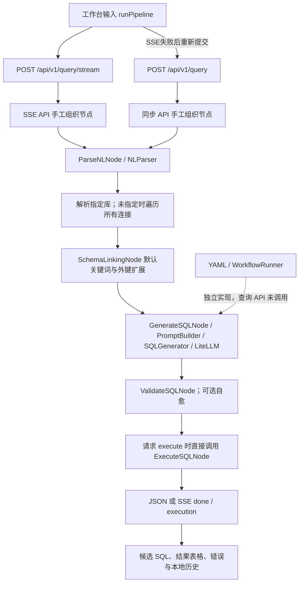

# NL2SQL 项目实际代码扫描与优化评估

评估日期：2026-10-20（Asia/Shanghai）。代码基准：`118f9d6` 加当前工作区；开始时 `pyproject.toml` 已有未提交变更，未覆盖。本文是调研结论和后续建议，**不是已实施的优化结果**。

配套材料：[验证与评测方案](2026-10-20-validation-plan.md)、[运行证据](evidence/2026-10-20/README.md)。证据标记：**确认**＝代码或隔离复现支持；**风险**＝有代码依据、尚未在目标环境测得影响；**增强**＝可选能力。完成度用“已实现／部分实现／桩或模拟／缺失／无法验证”，不以文件存在或测试数量换算完成百分比。

## 一、整体判断

项目处于**已有大量真实组件和可展示工作台，但运行主线、约束和质量基线尚未统一的集成型 MVP**。不是“只有 ExecuteSQLNode 实现”的初始骨架，也不足以称为经过端到端验证的安全 NL2SQL 产品。

已具备的能力包括中英规则解析、关键词 Schema Linking、提示词构建、多候选生成、SQL 语法与 Schema 校验、自愈重试、SQLite/DuckDB 执行，以及真实的 LanceDB＋SQLite FTS5＋RRF 检索组件。前端有落地页、登录页和多面板工作台；实际挂载在 FastAPI 上，并有真实 API 调用、SSE 消费和本地历史。

关键短板在于**组件能力没有等价地进入用户使用的主链路**：查询 API 绕开 WorkflowRunner；权限与全局调用预算没有形成执行闸门；默认 Schema Linking 没注入 RAG；历史、相似查询和业务规则未贯通；同步和 SSE 有两套逻辑。另已复现只读绕过、行数参数失效、索引残留和缺失节点被标为完成等问题。安全边界应与闭环建设一起完成，在开放共享环境前解决。

本次验证结果：

- 隔离副本执行现有测试：**2842 项，2833 通过、9 失败，4 warnings，55.35 秒**。9 项失败集中在 `tests/test_mcp/test_fastmcp_server.py`，当前 `mcp 2.2.0` 不再提供 `mcp.server.fastmcp`。
- Ruff：全仓 **192 项**，其中 `app/`＋`main.py` **158 项**；mypy：检查 140 个源文件，**62 个文件共 285 项错误**，包括缺少类型参数、第三方类型声明和调用契约不符。数量不是业务缺陷数量。
- 内存真实数据库复现：块注释 DELETE、WITH DELETE 和 DuckDB 多语句可绕过只读；`timeout_ms=1` 的 50ms 操作仍成功；API `max_rows=1` 和 `120` 均实际返回 100 行。
- 真实临时索引复现：文档从 9 块缩短到 1 块，LanceDB 为 1、BM25 仍为 9；Schema 从两列缩减到一列，两种索引仍均为 2。
- gstack 静态预览确认工作台在 1280×720、390×844 可挂载；首页未观察到横向溢出。未执行登录提交或真实模型的浏览器全流程。

**没有执行压测、真实 LLM/embedding 质量评测、生产监控或覆盖率采集。本文不提供吞吐上限、P95、召回率、SQL 准确率或覆盖率百分比。**

## 二、模块完成度与实际链路

### 2.1 目录、技术栈、启动和配置

- `main.py`：注册 12 个节点、6 类 Agent 和 MCP 配置、加载计划与子 Agent，再初始化 auth、RAG 和 LLM。`run_api()` 实际固定 `0.0.0.0:8001`；`Settings.app_host/app_port` 默认 8000 并未控制该入口。文件头的 `--web` 描述未见对应参数处理。
- `app/api/`：FastAPI 工厂，包含 query、schema、domains、auth、workflows、MCP、feedback、learning、documents、settings、SQL 工具、subagents。API 请求/响应有 Pydantic 模型；因此 AGENTS.md 的“Pydantic 仅用于 settings”也已过时。业务模型多数仍为 dataclass。
- `frontend_design/`：实际运行资源，不只是设计稿。`landing_page.html`、`form.html`、`workspace.html` 分别由 `app/api/__init__.py:140` 起的页面路由提供；其他 txt/HTML 为素材或原型，未发现全部被挂载。
- `app/nodes/`、`core/`、`harness/`：节点适配、业务组件、计划运行基础设施；另有 `agents/`、`subagent/` 的替代协调体系。
- `db/`：native 驱动连接、SchemaExtractor、sqlglot 方言转换。`knowledge/retrieval/` 是检索底层，`rag/` 是装配与刷新。
- `storage/mysql_store.py`、`auth/database.py`：两个独立 MySQL 基础设施池；另有 SQLite 反馈/查询对、BM25、LanceDB 和内存状态。业务数据源 SQLite 与账户存储不是同一套后端。
- Python 声明 `>=3.12`；依赖为 FastAPI/Uvicorn、LiteLLM、FastMCP、LanceDB、sqlglot/sqlparse、aiomysql/asyncpg/duckdb、JWT/bcrypt/AES-GCM 等。`pyproject.toml` 主要使用下限版本，无 Python 锁文件。前端 `package.json` 只有 Babel 开发依赖，没有可复现的 build/test/start scripts；页面运行时依赖 CDN React 18、Babel 7、Tailwind 和 Framer Motion，落地页另用 Three.js。
- 配置分布于 `.env`/Settings、`agent.yml`、计划 YAML、API 的 `_settings_store`/MySQL。不能将“设置保存成功”视为运行时已生效：LLM 设置会重建 router，Harness/DB/RAG 设置主要保存字典。
- 文档中的 `python main.py` 与 `uvicorn app.api:create_app --factory --port 8001` 初始化并不等价：工厂 lifespan 不注册节点、MCP 配置、PlanSelector 或主 orchestrator。当前直调节点的查询还能运行，会掩盖这种差异。

运行环境确认：默认 `python` 是 3.11.15；`.venv` 指向已不存在的 `D:\Users\31459\...\Python313\python.exe`。本次使用已有 Anaconda Python 3.13.9 加项目 `.venv/Lib/site-packages`，在忽略目录的临时副本执行，**未修复解释器、未安装依赖、未读取或输出真实密钥**。版本快照见配套方案。未发现已跟踪 Docker/Compose、CI 工作流或部署就绪探针配置。

### 2.2 用户真正走到的查询链路

关键事实与边界：

1. `frontend_design/workspace.html:895` 构建请求，默认 SSE，携带 `nl_text/domain/database/dialect/num_candidates/execute/validate/link_schema/model`，**没有 `session_id`**。SSE 出错后在 `1115–1124` 再提交同步请求。
2. `app/api/query.py:387`、`:1167` 是两套实际 pipeline。同步主线直接 `.execute(NodeInput(...))`，没有 setup/update 生命周期；SSE 部分生成路径调用 setup，但也未由 Runner 接管。
3. `ParseNLNode` 调用真实规则解析/SQR 构建；领域仅在请求非 default 时显式加载，default 领域不等于所有默认领域 YAML 已注入。
4. `_resolve_all_schemas()` 每次提取 Schema。未指定 database 时遍历所有连接并按 `database_name` 去重。两个主机上同名数据库可能合并；候选也按名称再找连接，不能代替稳定 `db_id`。
5. `SchemaLinkingNode` 有 RAG 委托分支，但 API 创建的是 `SchemaLinkingNode()`，`_retriever=None`。当前默认用词表映射、表列关键词、反向扫描和 FK 扩展。其返回的 `linked_schema` 没有传给生成器，API 在 `query.py:589` 仍传完整 Schema。
6. 有库的路径传 `rag_context=None`；无库或没匹配时才尝试领域、全局 schema RAG、最后 `llm_auto`。后者可能生成示例表 SQL，代码有 `source/source_note`，并跳过这些来源的执行；这是合理的来源区分，但不是数据库问答成功。
7. 校验有真实逻辑，但 `query.py:769` 未传 `business_rules`，故主线不执行领域业务规则校验。过滤失败候选并非强制闸门：无 schema_errors 的失败候选仍可保留；全部被过滤时也保留原列表，执行入口没有要求 `validation.passed`。
8. 执行结果来自真实驱动；同步会把执行失败放在候选 `execution.error`，顶层 errors 和统计可能仍认为成功。SSE 的正常分支只发成功 execution；节点返回错误时可能没有明确失败事件。
9. 同步查询保存内存 session，并尝试 MySQL 写入；SSE 主线没有同等会话/查询持久化。同步响应也没有返回自动创建的 session_id，历史上下文未再传给生成器。
10. 本次强制 Mock 时 SQL 是 `[mock response from mock/deepseek-v4-flash]`，可返回 HTTP 200／SSE done。**这只能证明接口运行，不能证明生成、校验、执行成功。**

### 2.3 分模块状态

- **页面与基础交互：部分实现。** 三个真实页面；工作台包括查询、Schema、连接、领域、SQL 工具、MCP、工作流、学习和设置。存在执行进度、候选、结果表、空状态、复制、编辑反馈和本地历史。证据：`workspace.html:734` ResultTable、`:771` ChatPanel、`:2607` WorkbenchPanel、`:5013` App；截图在 evidence。真实登录依赖 MySQL，未验证账户全流程。
- **API 契约：部分实现。** 核心 QueryRequest/Response、候选和 SSE 事件真实；其他管理接口不少接收原始 dict。错误混合 HTTPException、HTTP 200＋status:error、warnings、SSE error；无统一错误码、请求关联 ID 或取消协议。
- **解析、生成、校验、执行节点：已实现组件，部分接入。** `parse_nl.py`、`generate_sql.py`、`validate_sql.py`、`execute_sql.py` 有真实执行逻辑，不是桩。生成器可调用真实 LiteLLM，但默认无 router 的节点自行进入 mock，启动注册也未注入真实 router。真实模型在本次无法验证。
- **其他节点：已实现或带依赖的部分实现。** format_sql、dialect_translate、reflection、explain_plan、respond 有业务逻辑；metric_resolve 依赖语义层引擎，hybrid_search 依赖三个检索后端。`main.py` 无参注册这些节点，未形成完整注入链。`_template.py` 是明确的开发模板，不算产品功能。
- **Harness：部分实现，主流程未接入。** Runner 顺序运行、evaluate、重试和 JSONL trace 均有代码；没有把权限、配置预算、所有失败策略落实为统一边界。详见 F02/F03。
- **RAG：底层已实现，用户查询接入不完整。** Schema/Metric/Document 三个 namespace、embedding、FTS5、RRF、文档切分、刷新和上传 API 真实；没有独立语义重排器。Metric/Document 检索未进入主 Query 的生成上下文；SchemaRetriever 有实现但未注入。见 `knowledge/retrieval/*`、`knowledge/schema_retriever.py:138`、`rag/engine.py:150`。
- **领域语义与学习：部分实现。** DomainManager、GlossaryManager、RuleEngine、MetricFlowLayer、反馈持久化、SQL 修正模式挖掘、规则审核均有代码和组件测试。主线没有读取相似查询作为 few-shot；学习面板的 accuracy 是高评分反馈占比（`api/learning.py:82`），不是标注集 SQL 结果正确率。
- **数据库：4 种真实连接/内省分支＋7 种缺失。** SQLite、DuckDB、PostgreSQL、MySQL 在 connections 与 extractor 中有实现；其余 7 类型明确抛 NotImplementedError。方言翻译配置不代表有连接/执行支持。本次真实 SQLite/DuckDB 可验证，PostgreSQL/MySQL 无测试凭据，未验证。
- **鉴权与敏感信息：部分实现。** auth 有 bcrypt/JWT、用户接口依赖；LLM key 有 AES-GCM 存储和单独展示接口遮蔽。业务路由无身份与所有权检查，默认密钥未强制替换；PII 有标记/提示词标识，但执行结果不做统一脱敏。不能称为完整权限体系。
- **MCP：混合状态。** registry/config、transport/client 包装有实现；`api/mcp_api.py` 的内置 running 列表、健康更新、资源内容和工具调用包含模拟路径，启动并没有自动运行 8081–8084 的真实服务。外部 NL2SQL server 当前有导入失败，内部工具还有旧契约。配置注册或 SSE 的 mcp_call 事件不证明发生了真实 MCP 网络调用。
- **多 Agent／子 Agent：部分实现，默认依赖装配不足。** orchestrator、协作模式、独立 registry/bus 有实现；默认 SQLGenerationAgent 无 generator 会成功返回空候选，ToolExecutionAgent 无 client 时返回 stub。不是当前 Query API 的实际引擎；SSE agent_handoff 标签不能视作真实调度证据。`PlanSelector` L1/L2/L3 有代码，主 API 未使用。
- **缓存：组件已实现，主查询未接入。** QueryPairCache 有 L1/L2；API 未调用。注释中的“20%/15%查询”等不是实测命中率。
- **追踪与运维：部分实现／部分缺失。** WorkflowTrace 可写 JSONL，但主 API 用最近 100 条内存摘要；performance 工具有代码、未见核心链路埋点接线。`/health` 固定 ok；无依赖 readiness、统一指标导出、CI 门禁或部署基线。

### 2.4 Harness 不变量逐项结论

- **Runner 由 plan.node_order 驱动：实现层面确认。** `harness/runner.py:82` 顺序遍历，未让 LLM 决定下一个节点；反思跳转是代码固定规则。
- **所有用户工作流必须由计划与 Runner 决定：当前不满足。** 查询 API 自己拼接流水线，配置 `workflow.default/auto_select` 不控制实际执行路径。
- **LLM 不得决定流转：主 API 未观察到 LLM 决定下一个节点。** 但 `workflow/plan_selector.py` 的 L3 使用 LLM 选择 plan，若未来直接接入，就会与“LLM 绝不决定工作流走向”的严格要求冲突；不能按现有设计直接接线。
- **节点互不调用：生命周期互调未发现，但存在直接代码耦合。** `nodes/explain_plan.py:149–154` 调用 ExecuteSQLNode 的三个私有静态方法。没有调用对方 execute 来串流程，但不满足严格的节点独立依赖边界，应抽到公共执行/分析服务。
- **setup→execute→update：节点基类/Runner 有实现，主 API 没有统一遵循。** Runner 中 evaluate 实际在 update 前，跟部分说明顺序不同，应固定契约并写测试。
- **约束不能绕过：当前不满足。** PermissionManager 默认 deny 本身真实，但执行路径没有统一调用它；`_is_tool_allowed`、`record_llm_call/can_call_llm` 只见定义，没有业务调用点。

## 三、优化清单

优先级：**P0**＝闭环或开放使用前的安全阻断项；**P1**＝下一阶段必做的正确性/稳定性工作；**P2**＝基线后改进；**P3**＝可选增强。工作量为熟悉代码的一名工程师的粗估人日，含相应验证，不是排期承诺。各项存在交集，不应机械相加。

### F01　只读保护可绕过【确认，P0】

- 证据：`nodes/execute_sql.py:175` `_is_write_statement` 首词安全则提前返回；没有完整 AST/语句数检查。`evidence/.../probes.txt` 的 comment_delete、cte_delete、duckdb_multistatement 均实际删除临时数据。
- 影响：只读宣称不成立；API 未鉴权时影响范围进一步扩大。SQLite 自身拒绝部分多语句不能替 DuckDB 或其他驱动提供保护。
- 建议：收敛到唯一执行闸门；方言感知单语句只读 AST 白名单，检查嵌套/写 CTE/副作用语句；生产连接使用只读账号/事务或驱动只读模式，双层保护；写权限不能由普通节点 config 自行开启。
- 工作量：2–4 人日。前置：明确 MVP 支持数据库；验收覆盖所有执行入口。

### F02　主查询绕开计划、权限和调用预算【确认，P0】

- 证据：`api/query.py:387/:1167`；`harness/runner.py:47` 使用默认 ConstraintLimits；`nodes/agentic.py:187` 仅记录 denied_tools；全仓未找到 LLM 预算方法和 `_is_tool_allowed` 的实际调用者。
- 影响：agent.yml 约束、ask/deny、计划开关与 UI 宣称不一致；多库×多候选×自愈可超出配置预算。
- 建议：在应用服务中统一入口，由固定计划/Runner 调度，API 只负责协议适配；预算、权限、取消检查放在实际工具/LLM调用前。保留已有多库来源处理时需定义固定子步骤，不能简单替换为当前未装配的 Runner。
- 工作量：4–7 人日。前置：F01、明确节点输入输出、用回归样例保护多库/领域降级行为。

### F03　Runner 可错误地报告完成，计划语义未全部执行【确认，P1】

- 证据：`runner.py:88–97` 缺节点后继续，隔离复现返回 completed；`:83` 达迭代上限也可落到 completed；`:144` 重试使用默认约束，而非 plan.failure_policy；`:261` 未知 metric 直接通过。PlanLoader 读入的 on_pass/on_fail/depends_on 未被通用执行，reflection 的成功退出/修正回路未按 YAML 完整落地；max_candidates、mode 与生成器消费的 num_candidates/error_context 也有映射缺口。
- 影响：未来接入 Runner 后，失败、未运行或耗尽任务可能伪装成功；现有“反思循环”不能按图理解。
- 建议：加载计划时校验节点、配置和指标；未知项 fail closed；明确 aborted/exhausted/skipped 状态；限定实现顺序计划及一种可测的反思策略即可，暂不建设通用 DAG 引擎。
- 工作量：2–4 人日。前置：F02 的统一生命周期和状态定义。

### F04　鉴权未保护业务、状态无用户隔离【确认，P0】

- 证据：只有 `api/auth.py` 使用 Depends(get_current_user)；匿名 ASGI 请求数据源和 Harness 设置得到 200。ConnectionFactory 类级字典、query._SESSION_STORE、settings._settings_store、领域和反馈记录没有 owner；MySQL 相关表按 section/session/db 标识访问。
- 影响：登录界面不能限制查询、连接变更、全局模型设置、会话读取和索引操作；多用户会共享数据源及管理状态。
- 建议：MVP 先确定“单管理员私有工作台”或“多用户”范围。前者用简单统一身份与管理员检查即可；后者必须给数据源/会话/领域/文档加所有权并在服务端过滤。明确 CORS 来源，替换通配 origins＋credentials。不要先增加复杂 RBAC 产品。
- 工作量：私有管理员边界 2–4 人日；完整用户隔离 5–8 人日。前置：身份模式决策与测试账号/测试 MySQL。

### F05　领域名称可越过配置目录，秘密配置出口不一致【确认的代码缺口／利用面待测，P0】

- 证据：`api/domains.py:114/:237/:260–263` 仅 strip 后把 name 拼到 YAML 路径写入，没有字符约束或 resolve containment；`settings.py:209–215` 返回整个 settings store，区别于 `:224` 的专用遮蔽出口。`config/settings.py` 默认 JWT secret；`security/crypto.py:_derive_key` 从同一 secret 派生 AES key。
- 影响：可控相对/绝对路径可能写出 domains 根目录；完整设置出口可能暴露 api_key_enc 等内部字段。默认 secret 若未替换则 JWT 和密文保护均受影响。本次未利用真实文件或尝试解密真实凭据。
- 建议：领域 ID 使用有限字符；所有落盘路径 resolve 后必须在预定根下，创建不得覆盖；统一设置 DTO，仅返回“是否配置”而非密文；非开发启动拒绝默认 secret，JWT 与加密密钥分离并给出轮换恢复策略。
- 工作量：1–3 人日。前置：F04；路径边界和密文不回传可先独立验证。

### F06　行数、超时和校验结果没有成为强执行边界【确认，P0】

- 证据：`query.py:1118` 将 max_rows 放 context，节点从 config 读，所以 1/120 都变成默认100；`execute_sql.py` 只在文档声明 timeout_ms，未执行超时；节点 config 不 clamp 全局上限。`query.py:880–900` 允许失败/未校验候选继续执行。
- 影响：请求参数失真；长查询无法按服务端预算终止；校验失败仍可能运行。fetchmany 的返回行数限制不等于数据库工作量限制。
- 建议：统一 execution options，校验通过且只读才可执行；应用 timeout＋驱动/数据库 statement timeout；限制返回行数、字节数和读取方式；取消后关闭/回收任务与游标。
- 工作量：2–4 人日。前置：F01/F02；先覆盖 SQLite/DuckDB，再扩展 PG/MySQL。

### F07　同步与 SSE 的契约、错误和会话不一致【确认，P1】

- 证据：同步保存 session/MySQL 见 `query.py:949–990`；SSE 结束 `:1840–1906` 无同等写入；响应无 session_id，前端 body 也未发送。`QueryRequest:338–342` 只接受 validate 别名，run_validation=false 实测被忽略。阻断写语句为 HTTP200＋status:error；SSE 在流内验证模型、异常回传部分 traceback。
- 影响：多轮/版本历史不能可靠延续；客户按不同字段调用得到不同行为；前端和监控难以区分业务失败、服务错误和正常无结果。
- 建议：同一执行结果模型派生 JSON 与事件；返回并复用 session_id/query_id/candidate_id/db_id；兼容既有 validate 后固定字段规范；稳定错误码、失败阶段和可重试标识，traceback 仅服务端记录。候选必须携带库 ID，前端转工作台保留对应数据库。
- 工作量：3–5 人日。前置：F02/F03 的状态和追踪规范。

### F08　SSE 非实时 token、失败重发可能重复执行【确认机制／后果待测，P1】

- 证据：`query.py:1443–1452/:1598–1602` 等完整生成后再按词 yield token；`workspace.html:1115–1124` SSE 失败后重发同步请求；普通 _fetch 有30s timer，ChatPanel SSE fetch 没有总/空闲超时。前端 abort 主要在新 pipeline 开始时触发，后端没有明确取消契约。
- 影响：界面显示的 token 不代表 LLM 首 token 时间；断线可能重复产生费用或数据库查询；用户无法判断后台是否仍执行。
- 建议：先统一阶段事件与真实完成状态；如需实时 token，透传生成器异步流；用 query_id 幂等提交/重连或查询任务状态，取消与失败重试分开。MVP 可以先只做可靠阶段进度，不必强求 token 动画。
- 工作量：2–4 人日。前置：F07、统一请求预算。

### F09　启动、依赖与前端编译不可稳定复现【确认，P1】

- 证据：失效 `.venv`、Python版本不符；pyproject 无 Python锁文件，当前 fastmcp4.0.5/mcp2.2.0 与旧 FastMCP import 冲突；main 与工厂初始化不同。`workspace.html:3846` 含 `const parts: string[]`，本地 Babel8 与浏览器 Babel7显式 transform 都报 DeclarationMissingInitializer，form可解析；但静态预览中存在已编译 inline script且页面挂载成功，来源/缓存影响未厘清，**不认定已证实白屏**。
- 影响：新环境和干净浏览器结果不确定；构建检查不能稳定保护页面；调整模型/驱动前缺少可复现实验环境。
- 建议：固定受支持的 Python 和依赖集；将初始化收敛到 lifespan，并关闭相应资源；提供无外部服务的 offline profile 和明确的依赖 readiness；前端建立明确 JS 或 TS 编译路径与 smoke 检查，先消除源码解析不一致。MCP 若非本轮核心，可显式禁用并单独修复。
- 工作量：2–4 人日。前置：确定 MVP 部署/依赖范围，不要在此阶段引入大型前端迁移。

### F10　真实 RAG 组件未接入主生成上下文【确认，P1】

- 证据：`schema_linking.py:225/:267` 依赖注入才走 RAG；API 无参创建。`query.py:589/:593` 传完整schema与空rag_context；Metric/Document检索没有进入 Query；`HybridSearchNode()` 注册时也无后端。history、similar_pairs、business_rules 有组件消费但主API没传。
- 影响：不能把索引条数/上传成功当作检索增强生效；大Schema提示词可能按名称/预算截掉相关表；多轮和少样本能力停留于组件。
- 建议：先贯通“指定db_id→SchemaRAG→过滤后的Schema→SQL”并保留来源；再接领域规则与少量审定查询对，最后按需求接文档/指标。不要默认将所有namespace结果拼进上下文。
- 工作量：3–5 人日。前置：F07的库身份、F11/F12索引一致性与标注集。

### F11　索引更新不能正确删除旧片段/旧列【确认，P1】

- 证据：`document_store.py:388–419` 清除旧 LanceDB parent chunks，BM25只 upsert新块；`schema_rag.py:index_schemas` 只替换提交的doc_id。真实临时索引结果见 probes.txt：9→1时BM25仍9；2列→1列后均2。
- 影响：已移除的业务规则、段落或字段仍可召回；两套索引不一致，后续正确率比较不可信。
- 建议：按稳定parent/db版本构建更新集，显式删除旧范围、验证两端doc_id集合；为失败更新保留上个完整版本并记录状态。MVP先做幂等全库替换和每文档替换，无需先引入分布式索引事务。
- 工作量：2–3 人日。前置：明确文档/Schema主键与源数据保留策略。

### F12　文档检索遗漏正文、过滤晚于Top-K【确认机制／质量损失未测，P1】

- 证据：`document_store.py:541–546` embedding_text仅标题＋首行最多120字符，`:410` BM25也用此文本＋keywords；正文其他内容不进入这些检索文本。Schema/Metric/Document均先RRF截Top-K再过滤db/domain。切块大小参数保存为实例值，但 `_chunk_document` 调 `_split_markdown(content)`，实际全局默认分块参数未随实例设置传下去。
- 影响：正文中的关键条件可能不可检索；其他域命中占据名额，过滤后少于K。当前没有标注数据，不能给召回下降幅度。
- 建议：让dense与sparse覆盖完整chunk及标题；使用实际tokenizer或语言感知长度；先做授权范围过滤，再召回融合，并在目标域内补足K；参数通过可验证的调用链生效。
- 工作量：2–4 人日。前置：F11与检索标注基线；重排模型属于后续增强。

### F13　embedding版本与RAG设置缺少生命周期【确认／风险，P1】

- 证据：`lancedb_store.py:247–269` 维度不符直接drop并重建namespace；BM25不随之重建。engine默认Settings为Ollama，未知provider或openai无环境key可回退Mock；`settings.py:367–375` 更新RAG字典，未重建engine。top_k/threshold/model在不同调用点并未统一使用；`IndexRefresher.schedule_refresh` 未发现启动调用。
- 影响：切换模型可能丢掉文档向量，或同维不同模型混用；界面设置与实际行为不一致；“自动刷新”不能只凭函数存在确认。
- 建议：记录provider/model/version/dimension、数据版本与实际运行参数；不兼容时拒绝混用，先重建到新索引并验证后切换；保留原始文档以重建；设置区分已保存/已应用/待重建，未启动调度时明确为手动刷新。
- 工作量：2–4 人日。前置：F11、原文存储与配置生效契约。

### F14　NL2SQL评估和领域规则缺少业务级基线【确认，P1】

- 证据：`ValidateSQLNode`五阶段有实现，类型/性能/业务规则主要为告警；主API不传business_rules；`core/prompt_builder.py:439` 两张表就可加入多表候选提示；候选confidence有启发式而非校准结果。测试conftest强制Mock，学习accuracy是用户评分代理。
- 影响：可执行、语法正确和回答正确不能互相替代；多候选数量不能证明质量提升；不能据当前测试选择模型或宣称准确率。
- 建议：采用人工校验gold SQL/结果的中英基线；明确强制业务规则与提示建议；测单候选主结果和候选oracle上界，观察多表提示、schema过滤、自愈各自收益。数据/指标定义先于复杂agent协作。
- 工作量：评测框架2–3人日；首批标注约3–5人日另计业务复核。前置：F07/F10、冻结Schema与业务语义。

### F15　业务连接共享native实例且关闭语义不完整【确认结构／并发后果待测，P1】

- 证据：`db/connections.py:49–52` 全局连接字典；PostgreSQL每库单connection，MySQL建pool后只acquire一个连接长期保存；close/close_all直接调用conn.close未对asyncpg await，MySQL先pool.close再安排wait_closed且未明确release；应用shutdown仅关闭基础设施MySQL/auth池。
- 影响：同一asyncpg连接重叠操作、游标状态/关闭竞争、多worker状态不一致是明确待测风险；不能直接宣称已经出现高并发瓶颈。
- 建议：每请求从有界pool借还连接，或MVP先按db_id串行化执行；统一异步关闭、shutdown close_all与后台任务取消；定义进程级状态边界。单实例闭环前不必引入Redis。
- 工作量：3–5 人日。前置：F06，目标PG/MySQL隔离环境与并发测试。

### F16　异步路径有同步I/O和全量数据工作【确认结构／性能影响待测，P1】

- 证据：SQLite/DuckDB执行、FTS5/LanceDB调用、部分文件/SQLite反馈落盘在async函数中同步执行；`SchemaExtractor`多次对SQLite/DuckDB做COUNT(*)，查询每次重提Schema；PG执行 `execute_sql.py:_execute_asyncpg` 先fetch全部再切max_rows。BGE已用worker线程，Ollama已有Semaphore(8)，不能一概说全部embedding阻塞或无并发控制。
- 影响：事件循环占用、内存峰值、同库查询争用是风险，需要分阶段计时和负载观测确认。
- 建议：先去掉每请求全量计数/内省，按db/schema_version缓存；把确认阻塞的驱动/检索任务放有界worker或异步接口；PG用服务端行数限制/游标。先测量后决定线程数、索引和缓存。
- 工作量：2–5 人日。前置：F15与分段观测。此项不含任何实测吞吐结论。

### F17　LLM限流/重试恢复与总预算不足【确认／风险，P1】

- 证据：`core/sql_generator.py:180–192` 每库候选并发调用，API同步又并发多库；router有timeout60s与fallback，但 `router.py:441` 一次可重试异常即把provider标为False，后续跳过，未见自动half-open恢复；max_retries字段无对应重试循环。Ollama timeout120s，不是全链路预算。
- 影响：429/短暂故障后提供商可能持续不可用；请求扇出和自愈可放大费用，stream中途故障也未等价处理。
- 建议：统一请求级调用预算与deadline、模型/租户并发上限、有界排队、指数退避带抖动；对429遵守服务端反馈，熔断有恢复探测；tokens与成本计入重试和流式失败。当前只需一个简单限流器和可恢复状态机。
- 工作量：2–4 人日。前置：F02/F08与故障注入测试。

### F18　缓存组件未接入，缓存键也需先定义边界【确认／增强，P2】

- 证据：QueryPairCache存在，主API没有lookup/store；现有查询规范化/相似复用并非按所有schema/权限/模型版本完整隔离。
- 影响：目前不能声称缓存节省调用；贸然接入会跨库或过期复用SQL。
- 建议：先缓存不可变Schema/解析结果；后续NL→SQL缓存键包含授权范围、db_id、schema/domain/prompt版本、模型和影响SQL的选项，命中仍过校验/安全闸门；结果缓存另设数据时效策略。
- 工作量：1–3 人日。前置：F10/F15/版本失效机制；压测显示收益后再接语义缓存。

### F19　状态与追踪不能支持可信成功率【确认，P1】

- 证据：`query.py:995–1006` 按请求开关拼nodes_executed并以有SQL且errors空判断成功，候选execution.error不在其中；`workflows.py:16` 计划展示硬编码，`:26/:59` trace仅保留100条；`health.py`固定ok。节点级JSONL trace不在主API路径。
- 影响：失败查询可能被标成功，面板计划与真实执行不一致；重启后无法完整追溯，当前统计不适合性能或质量基线。
- 建议：阶段事件从真实生命周期发出；区分generated/validated/executed/cancelled/failed与业务正确率；贯穿query/session/db/node/model标识，分段耗时与token/成本；加依赖readiness与持久化失败告警。先结构化日志和少量指标，无需先建设完整观测平台。
- 工作量：2–4 人日。前置：F02/F07与保留/脱敏规则。

### F20　内存与多存储状态可能丢失或分叉【确认／风险，P1】

- 证据：query sessions无TTL清理；feedback内存列表无限增长；部分学习/trace列表有200/100条上限。多处保存异常被吞后仍返回成功。`schema.py`连接接口未调用MySQLStore.save_connection，启动也未见恢复业务连接的调用。版本rollback/branch仅操作内存，而查询会优先读MySQL历史。
- 影响：重启、多worker和存储故障下的历史、连接和版本表现不一致；“Write-Through用户数据不丢失”的README结论不成立。
- 建议：定义每类数据唯一事实来源及TTL；写失败返回明确的降级/未持久化标识；会话/版本使用一致存储；MVP明确单worker支持范围后再考虑共享状态服务。
- 工作量：2–4 人日。前置：F04/F07与部署模式。

### F21　前端有演示回退和模拟管理状态【确认，P1】

- 证据：`workspace.html:1161–1211` API离线时生成MOCK_SQL/MOCK_ROWS并存历史，已有toast、isMock与warning，不能说完全未标识；Schema/MCP也有fallback。`api/mcp_api.py`返回内置running、simulated资源，并在health接口仅更新registry。
- 影响：演示数据和真实执行仍共用结果/历史结构；用户短暂看不到toast时可能误解来源；管理按钮成功不证明真实服务启停或健康。
- 建议：演示模式需显式进入、结果永久显示来源，不进入真实历史/反馈统计；未实现的启停/健康应禁用或标明模拟；真实健康必须调用实际transport。先纠正状态真实性，再补更多面板。
- 工作量：1–3 人日。前置：F07/F19，MCP实际服务是否属于MVP的范围决策。

### F22　前端信息层级、无障碍和视觉系统需收敛【确认／部分待验，P2】

- 证据：四张截图；落地页灰绿3D、登录页Archivo粗边阴影、工作台Barlow轻边中性色，跨页一致性不足。工作台首页桌面/手机可用；ModalForm `:2199–2228` 没有dialog语义、focus trap或Escape逻辑；ModalField的label未通过htmlFor/id关联；未检索到aria-live或prefers-reduced-motion实现。首页按钮快照都有可识别名称，不能泛化为所有按钮不可访问。
- 影响：视力/键盘用户及小屏复杂面板可能受阻；技术性信息如plan id/“11种方言”占据主界面，但并非11种可用连接。
- 建议：MVP聚焦连接→选择库/领域→查询→校验/执行→结果/失败→重试/历史六步；统一字体、按钮、间距、状态文案；补dialog/表单关系、可见焦点、进度读屏和减少动画。对大表先分页/列展开，数据量证明需要时再虚拟化；低对比文本用量化检查确认。
- 工作量：3–5 人日。前置：F07/F21真实状态契约；无需先重写全部UI。

### F23　测试存在大量组件覆盖，但缺少严格的真实闭环门禁【确认，P1】

- 证据：conftest强制LLM_MOCK_MODE；`tests/e2e/test_full_pipeline.py:12` 的Runner测试只断言result非空，缺节点也可通过；部分节点/API测试只检查200或有字段。另有真实SQLite结果断言、注入/Mock传输测试，不能说测试全是假的。Ruff与mypy目前均不通过，缺CI。
- 影响：2833项通过仍会漏掉F01/F06/F07/F11；测试数量不能作为产品成熟度或模型质量指标。
- 建议：保留已有组件测试，增加少量高价值跨层测试（安全、单计划闭环、SSE/JSON一致、两用户、重启恢复、索引替换）；显式拆分mock单测与真实模型评测；把 lint/type新增问题和核心测试纳入CI，存量问题按影响分批收敛。
- 工作量：门禁/核心回归2–4人日；存量静态问题另估。前置：F09和验收数据集。

### F24　MCP外部工具仍有旧接口，默认Agent装配含空实现【确认，P2；对外发布前P1】

- 证据：9项失败；`mcp/fastmcp_server.py:106` 导入不存在的 `app.db.connection`，后续PromptBuilder/LiteLLMRouter调用使用旧参数；仅固定版本不足以保证工具可运行。`agents/sql_generator.py:execute` 无generator返回DONE空列表；`agents/tool_executor.py:201` 无client返回stub；子Agent默认无参注册这些Agent。
- 影响：协议/登记测试与真实工具调用有差距；当前不应宣称多Agent或外部MCP已完成NL2SQL闭环。
- 建议：MVP主线先统一服务，外部MCP只薄包装该服务；真实调用断言业务结果，缺依赖应显式unavailable。暂缓增加新协作模式；如不在当前范围，UI与文档清楚标为实验/未启用。
- 工作量：2–4 人日。前置：F02/F09和实际MCP客户端测试环境。

## 四、验证与评测方案

完整可执行场景、数据规模、并发梯度、指标公式和实验登记字段见[配套方案](2026-10-20-validation-plan.md)。本次已完成的验证与未来工作必须分开：

- **已运行**：全量现有pytest、Ruff、mypy；隔离SQLite/DuckDB/ASGI/LanceDB/FTS5探针；三个静态页面的gstack浏览与桌面/手机初始视口检查。
- **还需补充**：初始化/关闭、多用户权限、只读跨方言、JSON/SSE语义一致、取消/重连、索引替换与模型迁移、真实数据库生命周期；真实模型SQL结果评测；检索gold相关性标注；压力与稳态/故障测试。
- **数据需求**：首批120条SQL任务＋120条检索问题，先用其中30条跑通评测；中英成对、业务口径/跨表/时区/无答案/权限边界都有标注。模型评测使用冻结的schema与数据库快照，标注集不从待测LLM自动生成后直接当真值。
- **环境需求**：可复现Python与依赖、独立业务DB/账户DB、固定embedding和LLM版本；脱敏数据、只读账户、独立测试目录和密钥；先单worker，再测多worker一致性。真实模型费用按单独评测预算控制，本次未发生这类调用。
- **基线状态**：所有检索质量、SQL正确率、真实延迟/成本和吞吐的起始值均为**未测**。首轮先记录，后续在同一固定集/环境比较，不能以人为指定目标冒充实测。

## 五、分阶段路线图

### 阶段A：主流程闭环

范围：F09可复现启动、F02固定计划入口、F03可靠完成/失败状态、F07同步/SSE契约、F10最小SchemaRAG接线、F19真实追踪；同时完成F01/F04/F05/F06的开放前安全闸门。只以一种本地数据库和一个明确配置的模型完成首个业务样例，再扩到第二种方言。

交付：干净环境能启动；每个查询有session/query/db/plan版本；走既定节点顺序；真实模型SQL经校验执行并回传预期结果；失败不回报成功；没有API时显式不可用/演示。

排序依据：先让唯一链路可复现、可测且有安全边界，避免在两套逻辑上分别调优。该阶段不能以“主流程优先”为由延后只读和访问控制。

### 阶段B：安全与稳定性

范围：完善F04所有权/管理员模式、F05密钥与路径边界、F06执行预算、F08取消与幂等、F15连接生命周期、F17故障恢复、F20持久化；F11索引更新正确性也纳入数据稳定性。

交付：异常/断线/权限/重启测试有确定结果，连接和任务可回收，故障降级可见，用户间数据不串。此时才具备可扩大试用的基础。

### 阶段C：质量与性能

范围：F10/F12/F13/F14，建立可复用SQL和检索评测基线，再做F16性能剖析与压测；F18缓存、独立重排器、并行候选策略仅在对比实验证明收益后增加。

交付：分场景Recall@K/Precision@K/MRR/nDCG、SQL执行成功与结果正确率、耗时/成本；给出特定环境下吞吐和P50/P95/P99、错误与资源数据。每项优化可用消融实验说明收益和代价。

排序依据：先修索引/上下文正确性再选模型，先观测阻塞和连接争用再扩并发。不要以Mock流量吞吐替代真实模型服务容量。

### 阶段D：体验提升

范围：F21状态真实性、F22视觉与可访问性、结果/历史/多候选改进；简化不工作的MCP/多Agent展示。真实错误、来源、取消提示在前几阶段同步修正，深度视觉改版放在契约稳定后。

交付：核心六步可用，桌面与手机、键盘与读屏基础检查通过，真实/演示/无库/权限/超时/空结果均有明确状态；按试用反馈决定是否继续建设指标/文档检索面板及外部MCP（F24）。

## 六、首批行动项与可验证验收标准

以下是建议推进顺序；**本次没有开始实施**。每项只定义边界和验收，不提前绑定大规模重构。

1. **封住统一执行边界（F01/F05/F06，P0）。** 在临时库回归块/行注释、CTE写入、多语句、PRAGMA/ATTACH/导出等副作用、嵌套语句；所有执行入口拒绝非允许只读语句且数据/文件不变。max_rows=1确实返回1、全局上限不可超；超时/取消能在约定容差内终止数据库工作并回收资源。领域非法名称不能写出domains目录。
2. **建立真实身份与数据范围（F04/F05，P0）。** 选定私有管理员或多用户模式；未认证的查询/连接/设置/会话/索引写操作均拒绝；普通用户不能改全局LLM设置；若多用户，A不能读取/执行/删除B的资源。设置所有出口不含明文key或api_key_enc；非开发启动拒绝默认secret。
3. **建立可复现的单计划闭环（F02/F03/F09/F23，P1）。** 新的受支持Python环境一次安装后检查可重复；两个启动入口执行相同初始化/关闭。使用固定SQL测试替身先证明计划顺序和结果断言，再以明确配置的真实模型跑过至少30条审定冒烟任务；无模型/Mock必须显式报告，不能计为真实执行成功。缺节点、未知指标和迭代耗尽均不返回completed。MCP若未修复，应明确禁用，测试分类及失败清单可追踪，不能静默跳过。
4. **统一同步/SSE结果与会话（F07/F08/F19/F20，P1）。** 同一固定任务两种协议返回相同候选、校验、库身份和执行结果；均返回并复用session_id，刷新后历史/版本一致。用断网/取消测试证明SSE失败不会自动产生第二次执行；失败事件只有一次且带query_id/阶段/错误码，trace与实际节点一致，不泄漏traceback。
5. **修复并证明检索进入SQL上下文（F10–F14，P1）。** 文档长→短、Schema删列后两端doc_id集合一致、旧内容不可召回；仅出现在chunk正文的标注关键词可命中，db/domain过滤后结果不串域；生成prompt中确有检索来源和目标Schema，排除无关表。完成首批30条检索＋30条SQL基线记录，再扩到120条集；不设虚构准确率门槛，优化需同集比较且不破坏只读/权限测试。

五项先形成可验证的闭环、安全边界和质量起点。后续模型升级、高并发扩容、语义缓存和更复杂Agent协作，应依据这些基线决策。
