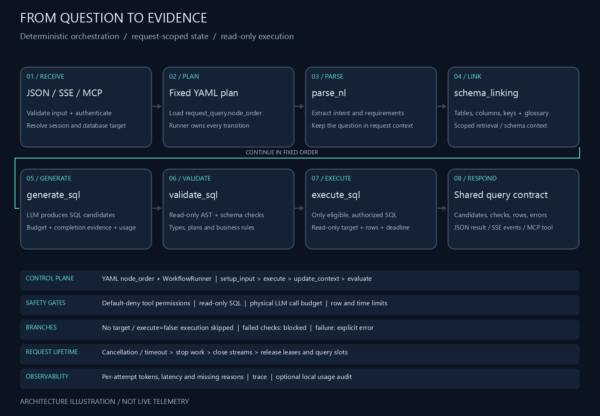

# Runtime flow / 运行流程

The README animation illustrates the current fixed request pipeline; it is not a live trace.
README 动画展示固定请求链路，不是实时运行记录或性能数据。



## Control and lifecycle / 控制与生命周期

`request_query.yml` defines parse_nl → schema_linking → generate_sql → validate_sql → execute_sql.
`WorkflowRunner` owns ordering and node setup, execution, context update and evaluation. Permissions,
read-only SQL policy, physical LLM budgets and resource limits constrain operations. A failed node
can abort the workflow; execution may be skipped or blocked. The LLM cannot select transitions.

固定 YAML 决定顺序；Runner 负责节点生命周期和评估。失败可中断流程，执行可跳过或阻断。
模型不能决定下一节点。认证和请求目标绑定先于执行，响应与审计明确保留失败或缺测。

## Cancellation and evidence / 取消与证据

Streaming completion is determined after consumption and completion checks. Cancellation and
timeouts close streams and release connection leases and query slots. Request-scoped attempt
records distinguish observed token usage from missing values; optional audit persistence is a
separate outcome. Do not infer business correctness, exact billing or instantaneous remote
server termination from successful client cleanup.

流式结果在消费和完成检查后确认；取消和超时触发收尾。逐次用量与缺测分开记录，可选审计
落盘具有独立状态。客户端释放资源不保证远端服务立即停止，也不证明业务答案或账单正确。

## Maintain the illustration / 维护图示

Install Pillow in a tooling environment, then run from the repository root:

```bash
python -m pip install Pillow
python scripts/render_readme_pipeline.py
```

The script writes an eight-frame GIF and a static PNG to `assets/`. It reads no environment
secrets and contacts no model or database. Font rendering may differ across platforms; use
an installed font path in the script for a consistent local rendering. The English README
also contains a GitHub-rendered Mermaid source for an inspectable text representation.

脚本生成八帧 GIF 和静态 PNG，不读取凭据、不调用模型或数据库。字体渲染可随平台变化。
英文 README 同时提供 Mermaid 文本源码；更新节点名称或执行语义时应同步更新两种语言。
